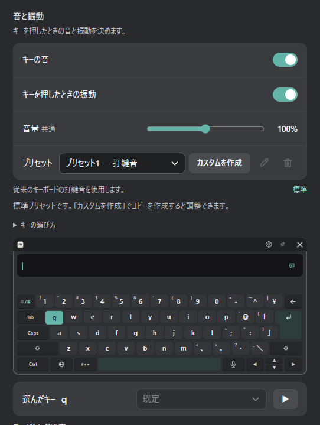
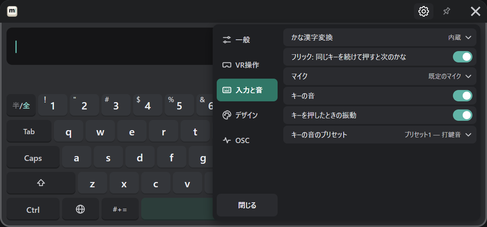
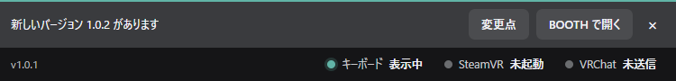
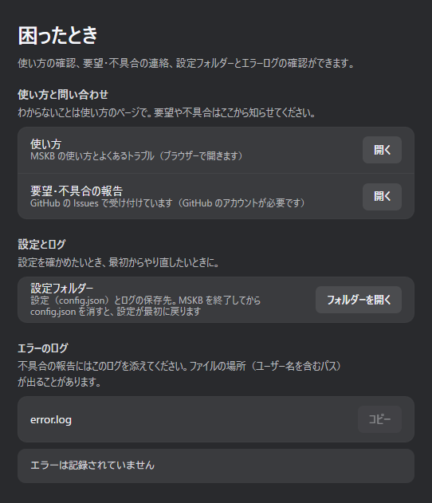
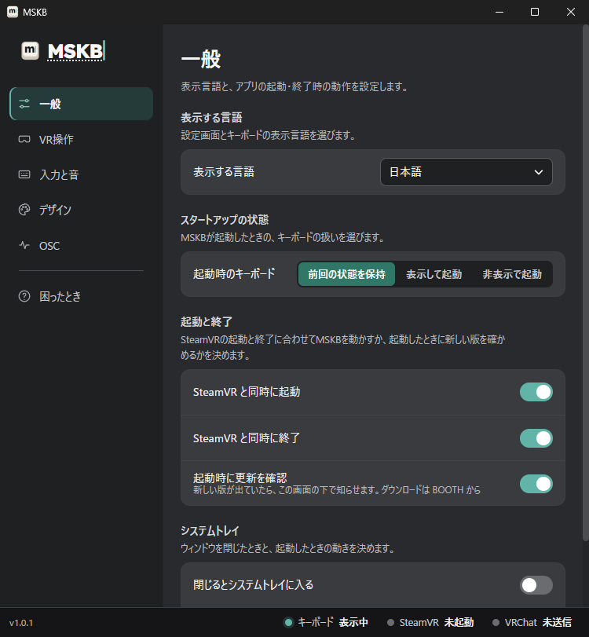

MSKB **v1.0.1** を公開しました。キーの音をプリセットで切り替えられるようになり、日本語の変換に PC の日本語入力も使えるようになりました。設定画面も、VR の歯車と同じ並びのまま見やすく整えています。

<!-- truncate -->

## 新しい機能

### キーの音のプリセット

キーの音を、まとめて切り替えられるようになりました。標準の「プリセット1 — 打鍵音」と「プリセット2 — 機械音」に加えて、自分好みに調整したカスタムのプリセットを 32 個まで保存できます。

- 「カスタムを作成」で今のプリセットのコピーを作り、キーごとの音を変えられます。変更は自動で保存されます。
- 選べる音を 6 つ増やしました。
- VR の歯車の「入力と音」でも、プリセットを選べます。

くわしくは [キーの音のプリセット](/customize#キーの音のプリセット) をご覧ください。

### かな漢字変換を選べるように

PC に Microsoft IME、Google 日本語入力、Mozc が入っていれば、日本語の変換にそちらを使えます。「入力と音」→「かな漢字変換」で選びます（[日本語](/input/japanese#かな漢字変換を選ぶ)）。

### 新しい版のお知らせ

MSKB を起動したときに新しい版が出ていると、設定画面の下でお知らせします。「変更点」でこのブログを、「BOOTH で開く」でダウンロードのページを開けます。

MSKB が自分でダウンロードや更新をすることはありません。お知らせが要らないときは、「一般」→「起動時に更新を確認」をオフにします。

### 使い方と問い合わせ先

設定画面の「困ったとき」から、このドキュメントと、要望・不具合の報告先（GitHub の Issues）を開けるようになりました。

## 改善

- **候補の段**：候補が多くても、変換中は右端の ‹ › がいつも出るようになりました。候補の段を指してトリガーを引いたまま左右に動かすと、スマートフォンのように候補を横に送れます。
- **設定画面**：各ページの先頭に、そのページでできることを書きました。項目の並びとアイコンを VR の歯車とそろえ、歯車にある項目が先に来るようにしました。
- **VR の歯車**：選択の一覧が長いときは、一覧の中だけをスクロールするようにしました。

## ダウンロード

- [ダウンロード（BOOTH）](https://misyaguziya.booth.pm/items/9093442)
- [不具合・要望（GitHub Issues）](https://github.com/misyaguziya/MSKB-Docs/issues)
