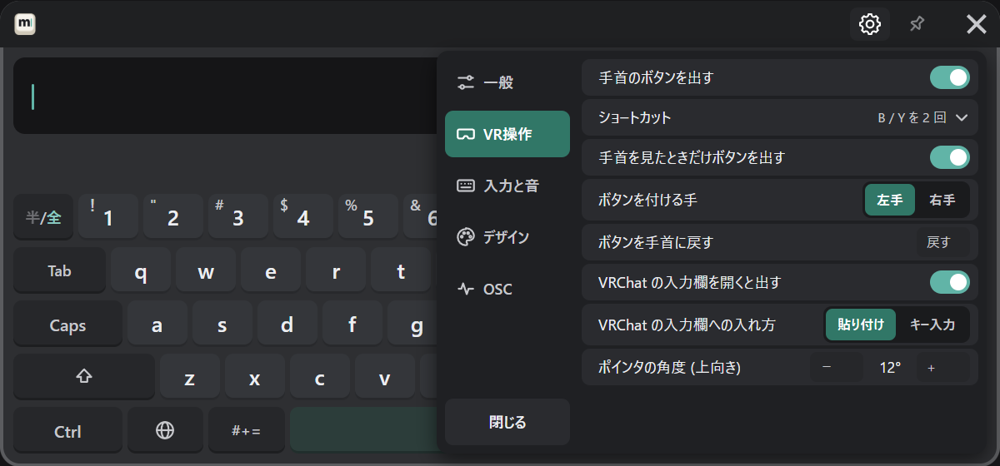
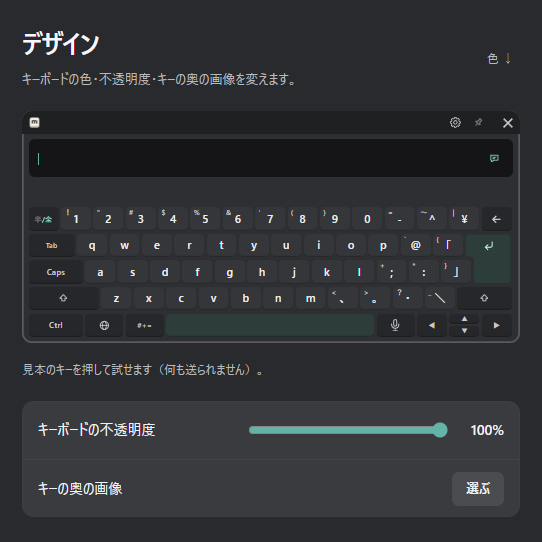
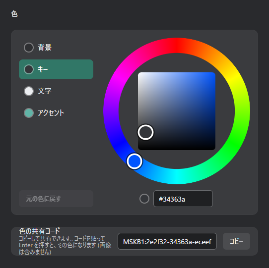
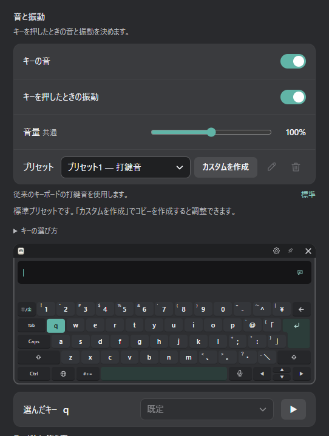

# 好みに合わせる

設定は、PC の設定画面と、VR のキーボードの歯車（③）のどちらからでも変えられます。PC にしかない項目もあります（[PC の設定画面](./settings/pc.md)、[VR の歯車](./settings/vr.md)）。

## キーボードの開き方

設定の「VR操作」で変えます。

| 設定 | 働き |
|---|---|
| 手首のボタンを出す | 手首に「MSKB」のボタンを出す |
| ショートカット | コントローラーのボタンでキーボードを開く・閉じる |
| VRChat の入力欄を開くと出す | VRChat の入力欄を開いたときにキーボードを出し、閉じると隠す |

ショートカットは次から選べます。

| ショートカット | 操作 |
|---|---|
| なし | 使わない |
| スティック押し込み 2 回 | スティックを 2 回押し込む |
| B / Y の長押し | B か Y ボタンを長押しする |
| B / Y を 2 回 | B か Y ボタンを 2 回押す |

手首のボタンを消すには、先にショートカットを選んでおきます（どちらも無いとキーボードを開けないため）。

MSKB を起動したときにキーボードを開いておくかは、「一般」→「起動時のキーボード」（前回の状態を保持／表示して起動／非表示で起動）で決めます。

## 手首のボタン

VR の歯車の「VR操作」で変えます。

| 設定 | 働き |
|---|---|
| 手首を見たときだけボタンを出す | 手首をこちらへ向けたときだけ出す |
| ボタンを付ける手 | 左手・右手 |
| ボタンを手首に戻す | ずれたボタンを手首の位置に戻す |

## ポインタの角度

指している向きと、ポインターの向きが合わないときに直します。
VR の歯車の「VR操作」→「ポインタの角度 (上向き)」で、− ＋ を押して 1 度ずつ変えます。

## 見失ったキーボードを戻す

- VR の中で：手首のボタンを長押しします。
- PC から：設定画面の「VR操作」→「目の前に戻す」を押します（SteamVR を起動し、ヘッドセットを着けて押します）。閉じているキーボードも開いて、正面に来ます。

## 見た目

| 設定 | 働き | 変えられる場所 |
|---|---|---|
| キーボードの不透明度 | キーボード全体の透け具合 | PC・VR |
| 色 | 背景・キー・文字・アクセントの色を色相環で選ぶ | PC・VR |
| キーの奥の画像 | キーの後ろに好きな画像を敷く（「外す」で戻す） | PC |
| 色の共有コード | 今の色をコードにして共有する。コードを貼って Enter でその色になる（画像は含まない） | PC |

PC の設定画面の見本のキーを押すと、見た目を試せます（VRChat へは何も送られません）。

「元の色に戻す」で、選んでいる所の色を最初の色に戻せます。

## 音と振動

| 設定 | 働き | 変えられる場所 |
|---|---|---|
| キーの音 | キーを押したときの音を鳴らす | PC・VR |
| キーを押したときの振動 | キーを押したときにコントローラーを振動させる | PC・VR |
| 音量 | すべてのキーに共通の音量（200% まで） | PC |
| プリセット | キーの音の組み合わせを選ぶ | PC・VR |
| キーごとの音 | カスタムのプリセットで、キーごとに鳴らす音を選ぶ | PC |

キーの音は、Windows の既定の再生デバイスから鳴ります。HMD から聞こえないときは [FAQ](./faq.md#キーの音が-hmd-から聞こえない) を見てください。

### キーの音のプリセット

PC の設定画面の「入力と音」→「音と振動」の「プリセット」か、VR の歯車の「入力と音」→「キーの音のプリセット」で選びます。

| プリセット | 音 |
|---|---|
| プリセット1 — 打鍵音 | ふつうのキーボードの打鍵音 |
| プリセット2 — 機械音 | 機械式キーボードの音。Space・Enter・Backspace・半／全も機械音になります |
| カスタム | 自分で作ったプリセット（32 個まで） |

標準の 2 つは変えられません。自分好みにするときは、PC の設定画面で次のようにします。

1. もとにしたいプリセットを選び、「カスタムを作成」を押します。
2. 名前を付けて「保存して使う」を押すと、そのコピーが選ばれます。
3. カスタムのプリセットへの変更は、そのまま自動で保存されます。

カスタムを選んでいるときは、名前の変更（鉛筆）、削除（ごみ箱）、「別名で保存」ができます。

### キーごとの音を変える

カスタムのプリセットを選んでいるときに、PC の設定画面の「入力と音」で変えます。

1. 見本のキーボードで、音を変えたいキーを押して選びます。言語キー（あ）で並びを、#+= で記号のページを切り替えられます。
2. 「選んだキー」の一覧から音を選びます。▶ で試聴できます。

- **ランダム**：「ランダム」を選んだキーと、既定で音が決まっていないキーは、「ランダムに使う音」で色の付いた音から 1 つ選んで鳴らします。音を押すと、使う・使わないを切り替えます。
- **音を取り込む**：自分の音を追加します（WAV・MP3・Ogg、512KB・3 秒まで）。取り込んだ音は、どのカスタムのプリセットでも使えます。
- 記号のページの字（記号・絵文字・顔文字・定型文）は、まとめて 1 つの設定です。
