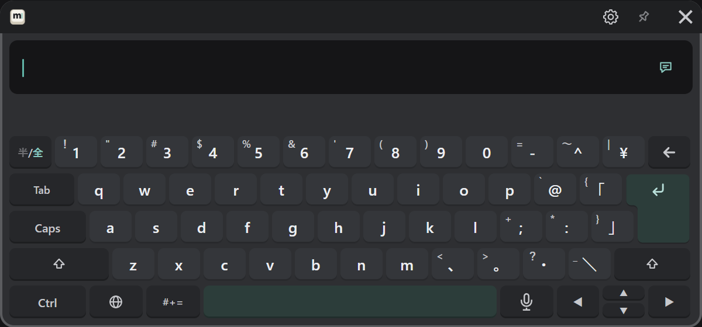

# MSKB

MSKB は、VRChat の中で使える多言語対応の VR キーボードです。
VR 機器を外さずに文字を打ち、VRChat のチャットボックスや入力欄へ送れます。

:::info
このドキュメントは MSKB **v1.0.0** に対応しています。使っているバージョンは、PC の設定画面の左下に出ています。
:::

## できること

| | |
|---|---|
| 入力 | 日本語（ローマ字・フリック）、English、한국어、简体中文、繁體中文（拼音・注音・倉頡・速成）、音声入力 |
| 記号 | 記号、括弧、図形、矢印・数、絵文字、顔文字、定型文 |
| 編集 | カーソル移動、選択、コピー・貼り付け、元に戻す、送った文の呼び出し |
| 送信 | VRChat のチャットボックスへ送る、VRChat の入力欄へ入れる |
| 見た目と音 | 色、不透明度、キーの奥の画像、キーごとの音、振動 |

設定画面とキーボードの表示は、日本語・English・한국어・简体中文・繁體中文から選べます。

## 必要な環境

- Windows PC
- SteamVR と、SteamVR で使える VR 機器
- PC 版 VRChat

Quest などのヘッドセット単体では利用できません。
初回の準備と、音声入力を初めて使うときは、インターネットに接続してください。

## 入手する

MSKB は [BOOTH](https://misyaguziya.booth.pm/items/9093442) で配布しています。

## 読む順番

| はじめて使う | [インストールと起動](./start/install.md) → [基本の操作](./start/basics.md) → [はじめての送信](./start/first-message.md) |
|---|---|
| 打ち方を知りたい | [文字を入力する](/input) |
| 送り先や送れないときのこと | [送る](./send.md) |
| 見た目・音・開き方を変えたい | [好みに合わせる](./customize.md) |
| 設定項目を調べたい | [設定の一覧](./settings.md) |
| うまく動かない | [FAQ](./faq.md) |
