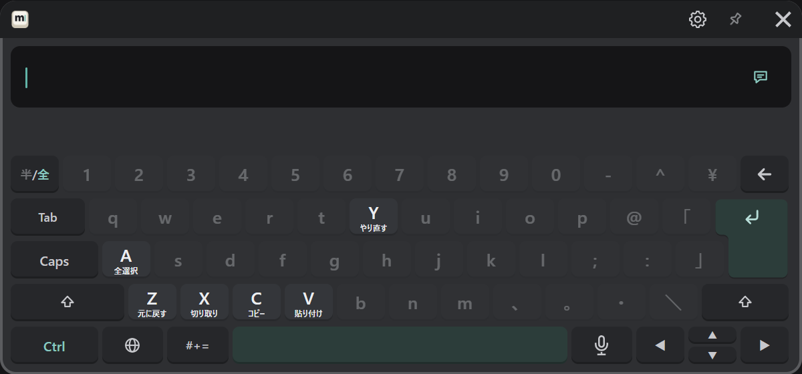

# 編集する

## カーソルを動かす

| したいこと | 操作 |
|---|---|
| 1 字ずつ動かす | ◀ ▶（長押しで続けて動く） |
| 単語ごとに動かす | Ctrl を押してから ◀ ▶ |
| 好きな位置へ置く | 入力欄の文の、置きたい位置を押す |
| 選択する | Shift を押してから ◀ ▶ |

## 消す

| したいこと | 操作 |
|---|---|
| 1 字消す | ←（長押しで続けて消す） |
| 全部消す | 入力欄の右端の「×」を、続けて 2 回押す |

「×」は 1 回目で色が変わるだけなので、間違えて押しても消えません。

## コピー・貼り付け・元に戻す

Ctrl を押すと、使えるキーだけが明るくなり、働きの名前が出ます。続けてそのキーを押します。

| キー | 働き |
|---|---|
| Ctrl → A | 全選択 |
| Ctrl → C | コピー |
| Ctrl → X | 切り取り |
| Ctrl → V | 貼り付け |
| Ctrl → Z | 元に戻す |
| Ctrl → Y | やり直す |

同じ操作は「#+=」→「定型・編集」のページにもボタンで並んでいます（[記号・絵文字・定型文](./symbols.md#定型文と編集)）。

Shift と Ctrl は、1 回押すと次の 1 キーだけに効き、素早く 2 回押すと固定されます。固定中にもう一度押すと戻ります。

## 改行する

Shift を押してから ↵ を押すと、送らずに改行します。

## 前に送った文を呼び出す

▲ を押すと、前に送った文が入力欄に出ます。続けて押すとさらに前の文、▼ で新しい方へ戻ります。
同じ文をもう一度送りたいときや、少し直して送り直したいときに使います。

## 文字数

VRChat のチャットボックスに出せるのは 144 文字までです。残りが少なくなると、入力欄の右端に文字数が出ます。
