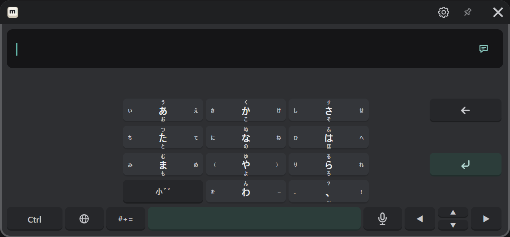
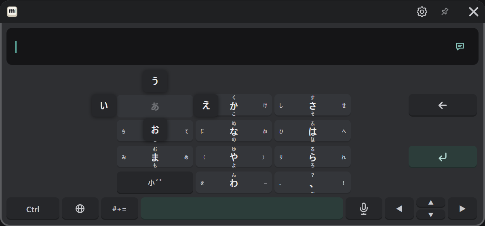

# 日本語（フリック）

🌐 キーから「日本語 (フリック)」を選びます。スマートフォンのフリック入力と同じ並びです。

## 打ち方

かなのキーを指してトリガーを引き、入れたい字の向きへポインターを動かして離します。
引いている間は、キーの周りに 4 つの向きの字が出ます。

| 入る字 | 操作 |
|---|---|
| あ（真ん中） | その場で押して離す |
| い | 左へ動かして離す |
| う | 上へ動かして離す |
| え | 右へ動かして離す |
| お | 下へ動かして離す |

動かさずに同じキーを続けて押すと、あ → い → う…と次のかなに変わります。
これを使わないときは、設定の「入力と音」→「フリック: 同じキーを続けて押すと次のかな」をオフにします。

## 濁点・半濁点・小さい字

「小゛゜」キーを押すと、最後に打ったかなが、濁点・半濁点・小さい字に順に変わります（か → が、は → ば → ぱ など）。

## 変換・確定

変換と確定はローマ字と同じです（[日本語（ローマ字）](./japanese.md#打って変換する)）。
