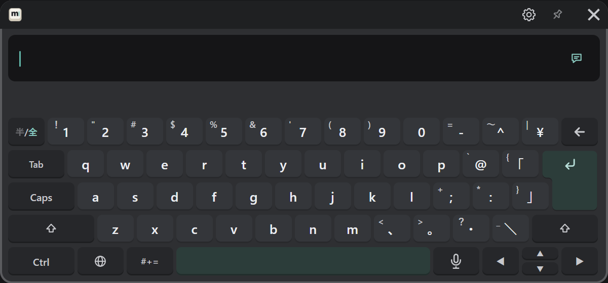
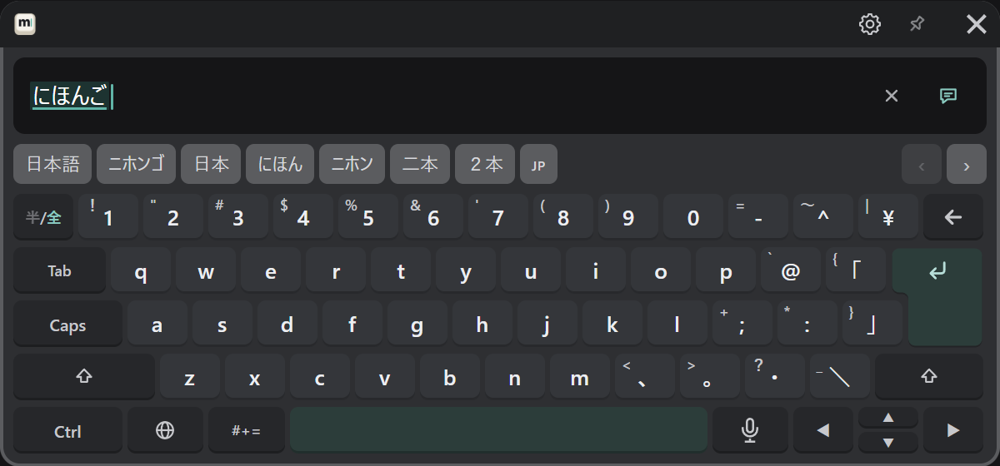
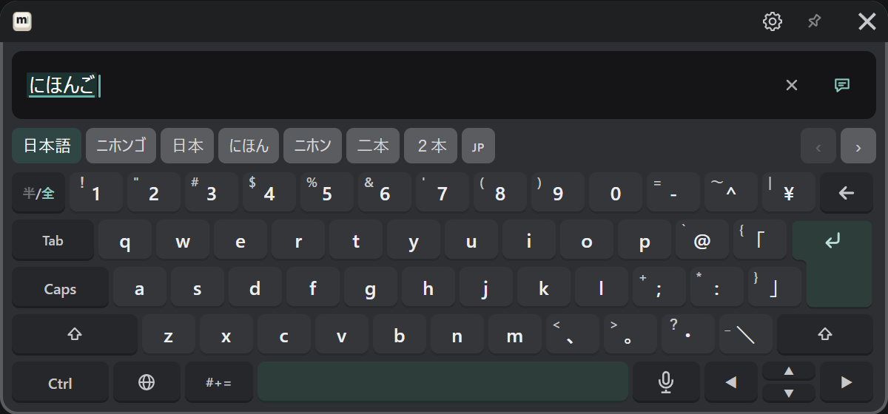

# 日本語（ローマ字）

🌐 キーから「日本語」を選びます。キーの並びは、日本語キーボード（JIS）と同じです。

## 打って変換する

1. ローマ字で打つと、入力欄にひらがなが出ます。候補の段には変換の候補が出ます。

   

2. 空白キーで変換します。選ばれている候補に色が付きます。候補の段から押して選ぶこともできます。

   

3. ↵ で確定します。

| したいこと | 操作 |
|---|---|
| 候補を選ぶ | 候補の段の候補を押す |
| 候補の続きを見る | 候補の段の右端の ‹ ›（候補が多くても、変換中はいつも出ています） |
| 見切れた候補を見る | 候補の段を指してトリガーを引いたまま左右に動かす（スマートフォンのように横に送れます）。スティックを上下に倒しても送れます |
| 変換する区切り（文節）を移る | ◀ ▶ |
| 確定する | ↵ |
| 確定して送る | ↵ をもう一度 |

よく選ぶ候補は、次から先に出るようになります。最初の順番に戻すときは、PC の設定画面の「入力と音」→「学習した変換をリセット」を押します（次に MSKB を起動したときに戻ります）。

## かな漢字変換を選ぶ

ふだんは MSKB に入っている変換を使います。PC に日本語入力（Microsoft IME、Google 日本語入力、Mozc）が入っていると、そちらで変換することもできます。
PC の設定画面か VR の歯車の「入力と音」→「かな漢字変換」で選びます。選んだ日本語入力が使えないときは、MSKB に入っている変換に戻り、そのことが歯車に出ます。

## 英数をそのまま打つ

日本語のまま英字や数字を打ちたいときは、左上の「半/全」を押します。もう一度押すと、かなに戻ります。
英語の文をまとめて打つときは、🌐 キーで English に切り替えたほうが、単語の予測が使えて楽です（[ほかの言語](./other-languages.md#english)）。

## 句読点・記号

「、」「。」などは、キーに書かれているとおりに入ります。キーにない記号は「#+=」から入れます（[記号・絵文字・定型文](./symbols.md)）。
