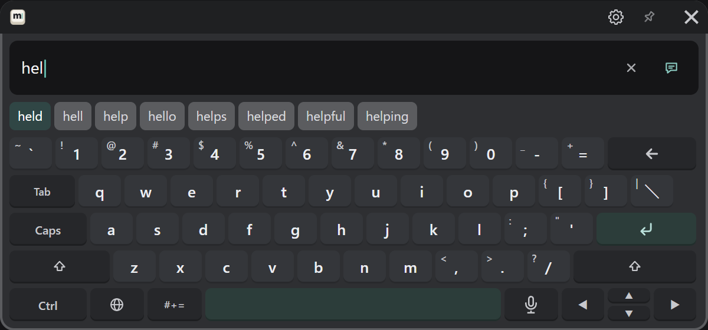
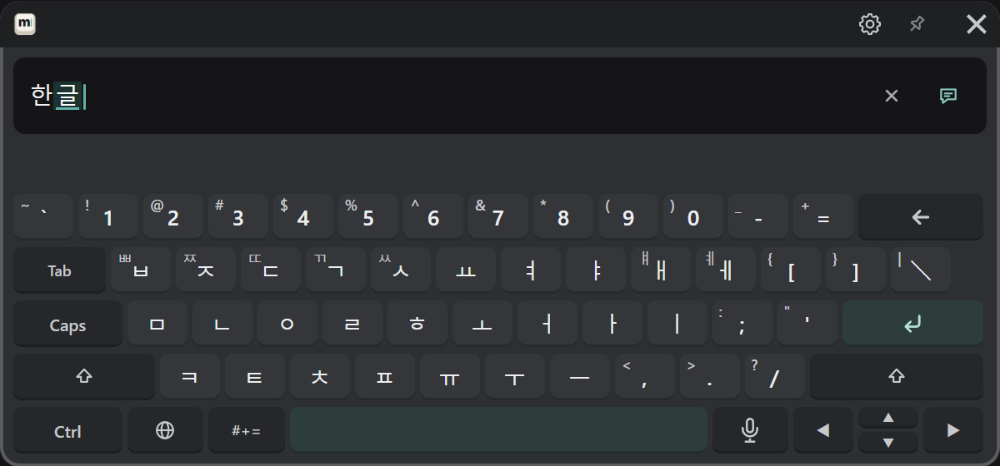
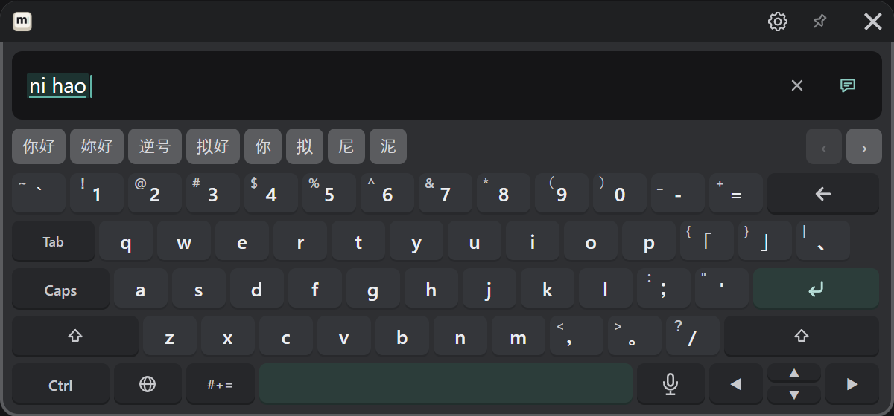
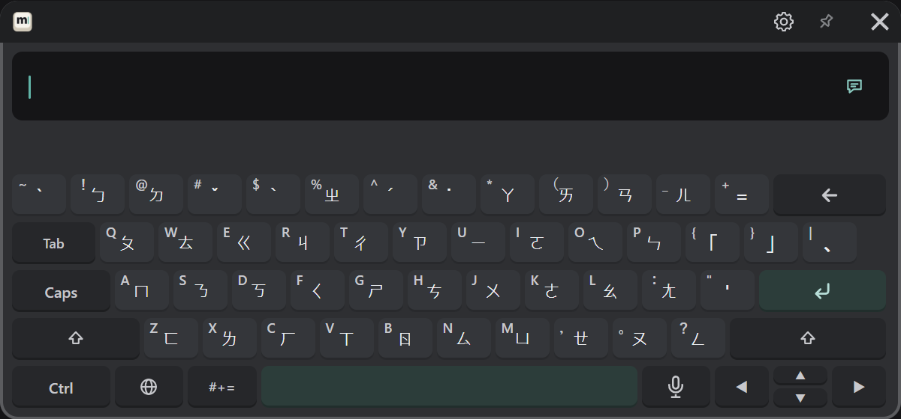
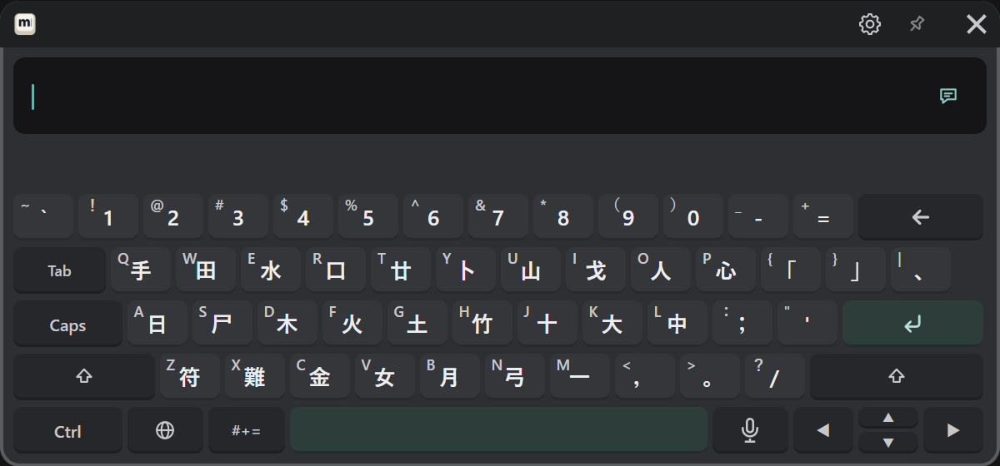

# English・한국어・中文

🌐 キーから言語を選びます。どの言語も、キーの左上の小さい字は Shift を押すと入る字です。

## English

英語のキーボード（US 配列）です。打ちかけの単語の候補が候補の段に出ます（画像は「hel」と打ったところ）。

- 候補を押すと、その単語が入ります。
- Tab で、先頭の候補（色の付いたもの）が入ります。
- 大文字は Shift（次の 1 字）か Caps（固定）で打ちます。

## 한국어

韓国語の 2 ボル式の並び（KS X 5002）です。字母を打つと、自動で音節にまとまります（画像は「한글」と打ったところ）。候補の段は使いません。

- 濃音（ㄲ ㄸ ㅃ ㅆ ㅉ）や ㅒ ㅖ は Shift を押してから打ちます。

## 简体中文・繁體中文（拼音）

🌐 キーから「简体中文」か「繁體中文」を選びます。拼音で打つと、候補の段に漢字の候補が出ます（画像は「nihao」と打ったところ）。

| したいこと | 操作 |
|---|---|
| 一番目の候補を選ぶ | 空白 |
| ほかの候補を選ぶ | 候補を押す |
| 候補の続きを見る | 候補の段の右端の ‹ › |

初めて使うときは、辞書の準備があります（[初回の準備](../start/install.md#4-初回の準備を待つ)）。

## 注音・倉頡・速成

🌐 キーから「注音」「倉頡」「速成」を選びます。繁體中文で入ります。
キーには、注音符号・倉頡の字根が書かれています。打ち方と候補の選び方は拼音と同じです。

**注音**

**倉頡・速成**（キーの並びは同じです）

