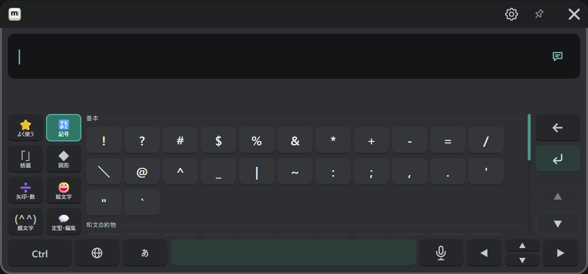
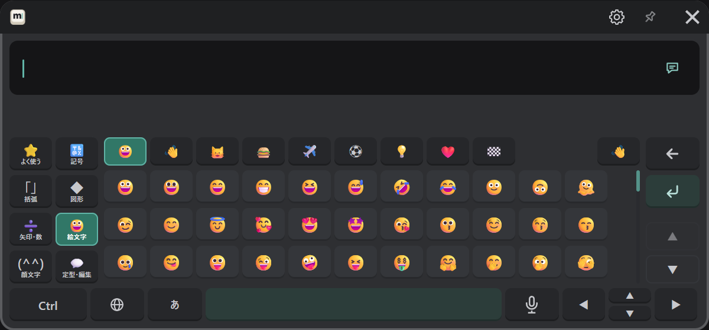
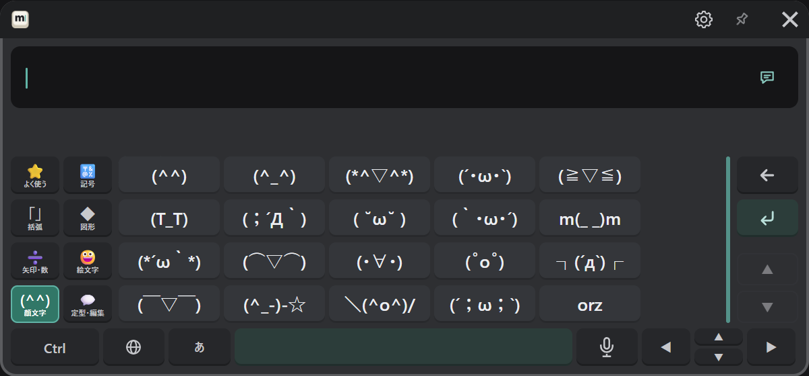
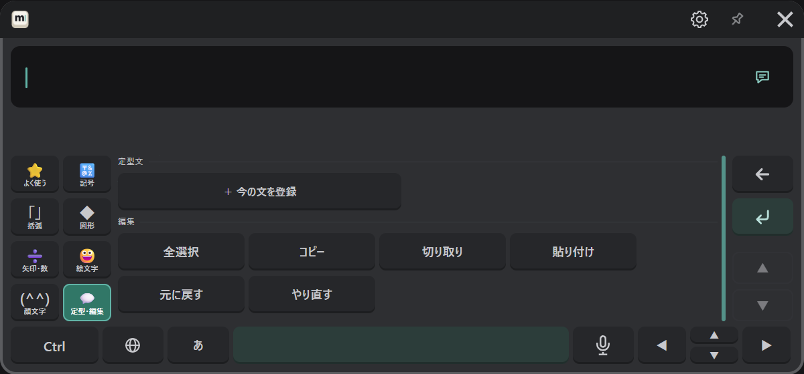

# 記号・絵文字・定型文

「#+=」キーを押すと、文字のキーが記号のページに替わります。左のタブで種類を選び、字を押すと入ります。
文字のキーに戻るときは、同じ場所のキー（言語の字が書かれています）を押します。

| タブ | 入っているもの |
|---|---|
| よく使う | 最近入れた記号（MSKB を起動し直すと消えます） |
| 記号 | 基本の記号、和文の約物、中文・韓国語の記号 |
| 括弧 | 括弧（両方が入り、カーソルが間に来ます） |
| 図形 | ☆ ○ ◇ □ △ ♪ ♡ など |
| 矢印・数 | 矢印、数学・単位（± ≠ ℃ など）、① Ⅰ などの番号 |
| 絵文字 | 絵文字（肌の色を選べます） |
| 顔文字 | 顔文字 |
| 定型・編集 | 登録した定型文と、編集のボタン |

一覧が長いときは、右の ▲ ▼ かコントローラーのスティックで送ります。

## 絵文字

上の段でグループ（表情、人・体、動物・自然、食べ物、場所、活動、物、記号、旗）を選びます。
右上の手のボタンで、肌の色を選べます。

## 顔文字

## 定型文と編集

よく使う文を登録しておくと、押すだけで入ります。

- **VR の中で登録する**：文を打ってから、「＋ 今の文を登録」を押します。
- **PC で登録する**：設定画面の「入力と音」→「定型文」に文を入れて「追加」を押します。

下の「編集」には、全選択・コピー・切り取り・貼り付け・元に戻す・やり直すのボタンがあります（Ctrl と同じ働きです）。
