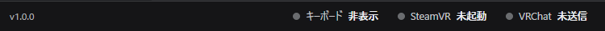

# 送る

↵ を押すと、入力欄の文を送ります。送る先は 2 つあり、入力欄の右端の印（[キーボードの各部](./start/basics.md#キーボードの各部) の②）で切り替えます。

| 送る先 | 印 | 送ったあと |
|---|---|---|
| チャットボックス | 吹き出し | VRChat のチャットボックスに出ます |
| VRChat の入力欄 | もう一方の印 | VRChat の入力欄に文字が入ります。最後の送信・決定は VRChat 側で行います |

:::note
入力欄右端の印は送信ボタンではありません。押すたびに送る先が切り替わります。送るのは ↵ です。
:::

## チャットボックスへ送る

VRChat の入力欄を閉じた状態で、送る先を吹き出しにして ↵ を押します。送れると入力欄が空になります。

- 打っている間、VRChat のチャットボックスに入力中の印が出ます。送ったときは通知音が鳴ります。どちらも設定の「OSC」で切れます。
- 送れないときは [FAQ](./faq.md#チャットボックスに送れない) を見てください。

## VRChat の入力欄へ入れる

VRChat の入力欄（ワールドの検索や、アバターの名前など）に文字を入れたいときに使います。

1. VRChat の入力欄を開きます。
2. MSKB で打って ↵ を押すと、その入力欄に文字が入ります。
3. VRChat 側で決定します。

VRChat の入力欄が開いている間は、↵ は送る先の印にかかわらずその入力欄に入ります（印も切り替えられません）。チャットボックスへ送りたいときは、VRChat の入力欄を閉じてください。

設定の「VR操作」→「VRChat の入力欄を開くと出す」をオンにすると、VRChat の入力欄を開いたときにキーボードが出て、閉じると隠れます。

:::caution クリップボードについて
初期設定では、VRChat の入力欄へはクリップボードを使って文字を入れます。それまでのクリップボードの内容は上書きされ、Windows のクリップボードの履歴にも残ります。
使いたくないときは、設定の「VR操作」→「VRChat の入力欄への入れ方」を「キー入力」にします。
:::

「VRChat が見つからないので、コピーだけしました」と出たときは、VRChat に貼れませんでした。打った文は入力欄に残っているので、VRChat を確かめてからもう一度 ↵ を押します。

## 送れたかを確かめる

PC の設定画面の下に、VRChat へ最後に送れたかが出ます。

| 表示 | 意味 |
|---|---|
| キーボード 表示中 / 非表示 | VR でキーボードが開いているか |
| SteamVR 連携中 / 未起動 | SteamVR が起動していて、MSKB が連携しているか |
| VRChat 送信OK / 未送信 / エラー | VRChat へ OSC で送れたか。「エラー」のときは「OSC」の接続先を確かめます |

「送信OK」は MSKB が送れたことを示します。VRChat が受け取ったかまでは分かりません。

## 同じ文をもう一度送る

▲ で前に送った文を呼び出せます（[編集する](./input/editing.md#前に送った文を呼び出す)）。
