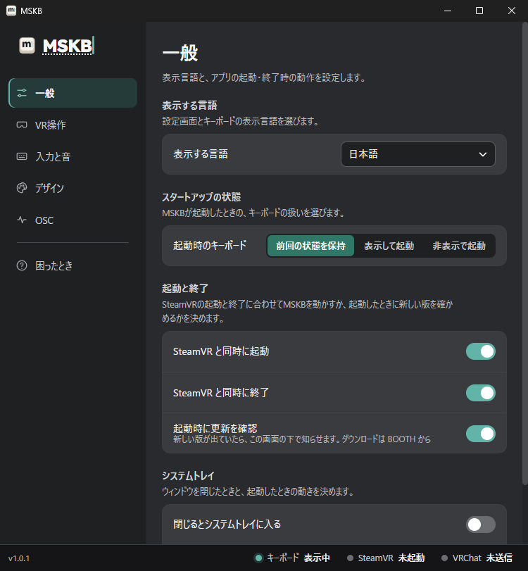
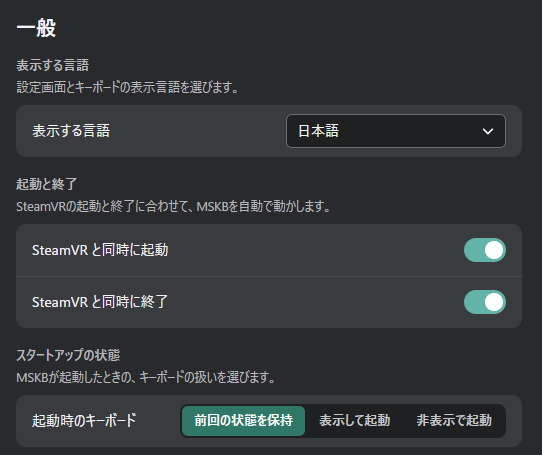
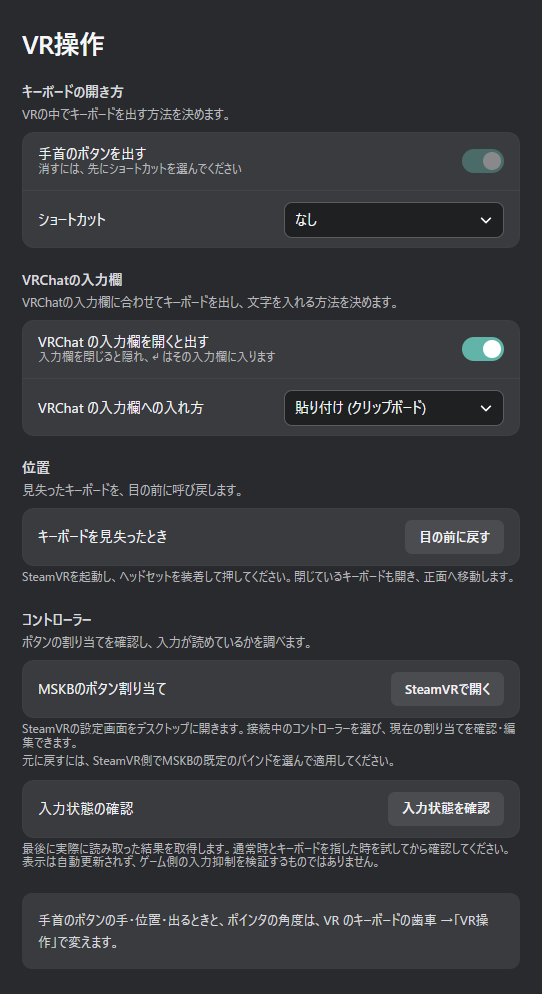
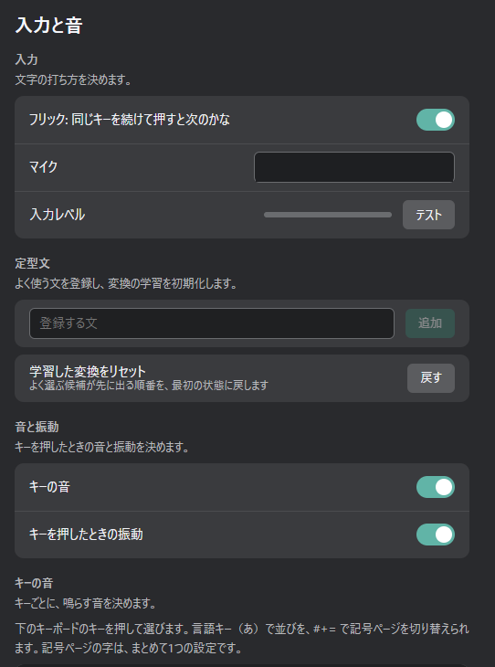
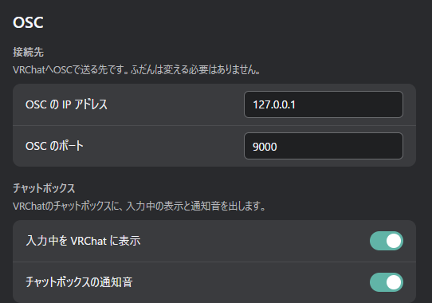
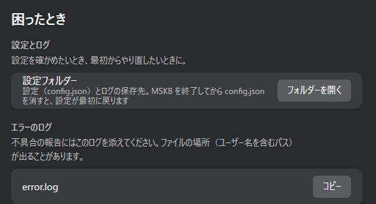

# PC の設定画面

Windows のタスクトレイにある MSKB のアイコンを押すか、右クリックして「MSKBを開く」を選ぶと開きます。

左の一覧でタブを切り替えます。下の帯は今の状態です（[送れたかを確かめる](../send.md#送れたかを確かめる)）。
表の「VR」の列に ○ がある項目は、[VR の歯車](./vr.md) でも変えられます。どちらで変えても同じ設定です。

## 一般

| 項目 | 内容 | VR |
|---|---|---|
| 表示する言語 | 設定画面とキーボードの表示言語 | ○ |
| SteamVR と同時に起動 / 終了 | SteamVR の起動・終了に合わせて MSKB も起動・終了する | |
| 起動時のキーボード | 前回の状態を保持 / 表示して起動 / 非表示で起動 | ○ |
| 閉じるとシステムトレイに入る | 設定画面の「×」で終了せず、トレイに入る（初期設定はオフ） | |
| システムトレイで起動する | 起動したときに設定画面を出さない | |

## VR操作

| 項目 | 内容 | VR |
|---|---|---|
| 手首のボタンを出す / ショートカット | キーボードの開き方（[好みに合わせる](../customize.md#キーボードの開き方)） | ○ |
| VRChat の入力欄を開くと出す | VRChat の入力欄と一緒にキーボードを出す | ○ |
| VRChat の入力欄への入れ方 | 貼り付け (クリップボード) / キー入力（[送る](../send.md#vrchat-の入力欄へ入れる)） | ○ |
| キーボードを見失ったとき | 「目の前に戻す」でキーボードを正面に出す | |
| MSKBのボタン割り当て | SteamVR のボタン割り当ての画面を開く | |
| 入力状態の確認 | コントローラーの入力を MSKB が読めているか調べる（[FAQ](../faq.md#キーが押せない指しても反応しない)） | |

## 入力と音

| 項目 | 内容 | VR |
|---|---|---|
| フリック: 同じキーを続けて押すと次のかな | [フリック](../input/flick.md) で、同じキーを続けて押したときに次のかなにする | ○ |
| マイク / 入力レベル | 音声入力に使うマイクと、そのテスト | マイクのみ |
| 定型文 | よく使う文の登録 | |
| 学習した変換をリセット | よく選ぶ候補が先に出る順番を最初に戻す（次の起動から） | |
| キーの音 / キーを押したときの振動 | 音と振動のオン・オフ | ○ |
| キーの音（キーごと） | キーごとの音、音量、取り込んだ音（[好みに合わせる](../customize.md#キーごとの音を変える)） | |

## デザイン

| 項目 | 内容 | VR |
|---|---|---|
| キーボードの不透明度 | 透け具合 | ○ |
| キーの奥の画像 | キーの後ろに敷く画像 | |
| 色 | 背景・キー・文字・アクセント | ○ |
| 色の共有コード | 色をコードで共有する | |

画像は [好みに合わせる](../customize.md#見た目) にあります。

## OSC

| 項目 | 内容 | VR |
|---|---|---|
| OSC の IP アドレス / ポート | VRChat へ送る先。ふだんは変える必要はありません | |
| 入力中を VRChat に表示 | 打っている間、チャットボックスに入力中の印を出す | ○ |
| チャットボックスの通知音 | 送ったときに VRChat の通知音を鳴らす | ○ |

## 困ったとき

| 項目 | 内容 |
|---|---|
| 設定フォルダー | 設定とログの保存先を開きます。設定を最初に戻す手順は、画面の説明に従ってください |
| エラーのログ | 不具合を報告するときに添えるログです。「コピー」で写せます |

:::caution
ログには、ユーザー名を含むファイルの場所が出ることがあります。公開の場所に貼るときは、ユーザー名の部分を消してください。
:::
