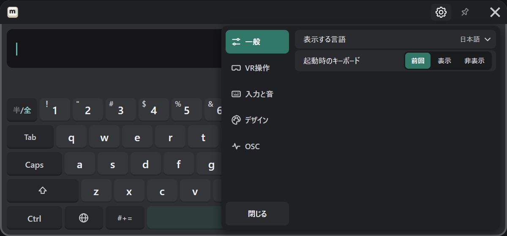
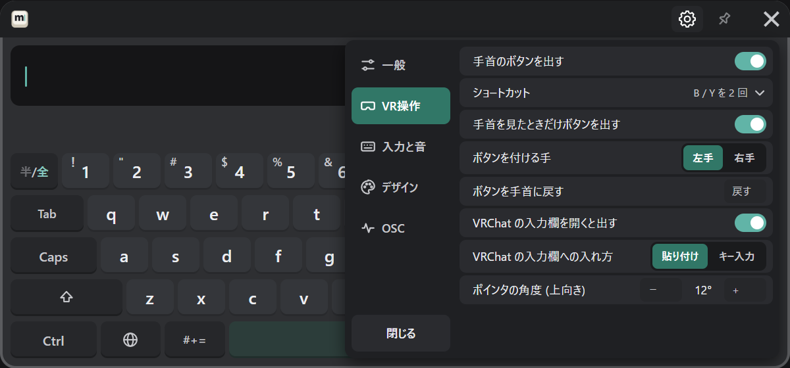
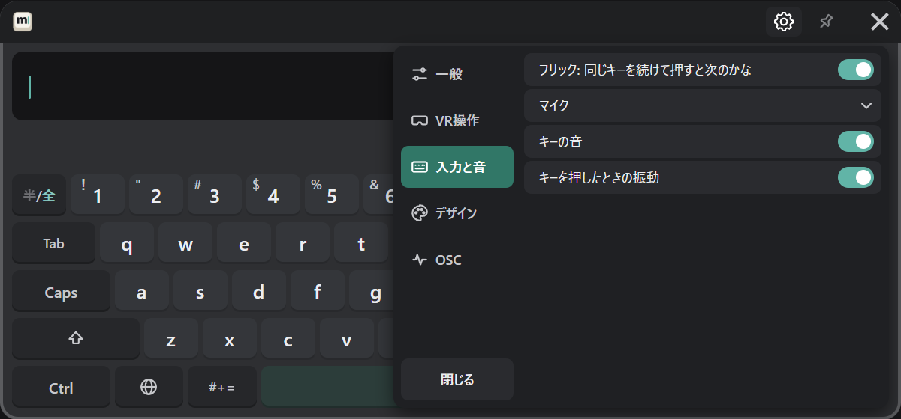
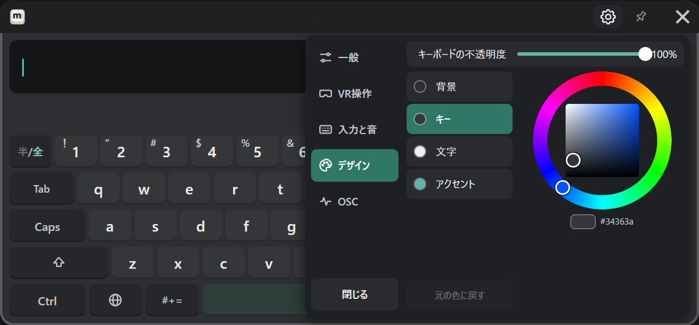
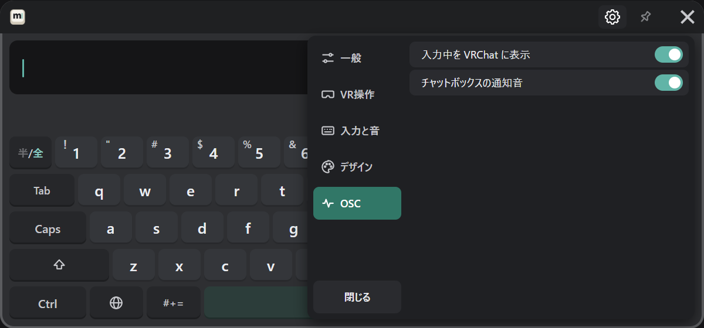

# VR の歯車

キーボード右上の歯車（[各部](../start/basics.md#キーボードの各部) の③）を押すと、キーボードの上に設定が開きます。
左のタブで切り替え、「閉じる」で戻ります。VR の中で変える意味のある項目だけがあり、どれも [PC の設定画面](./pc.md) と同じ設定です。

## 一般

表示する言語と、起動時のキーボード（前回 / 表示 / 非表示）を変えます。

## VR操作

| 項目 | 内容 |
|---|---|
| 手首のボタンを出す / ショートカット | キーボードの開き方（[好みに合わせる](../customize.md#キーボードの開き方)） |
| 手首を見たときだけボタンを出す / ボタンを付ける手 / ボタンを手首に戻す | 手首のボタン（[好みに合わせる](../customize.md#手首のボタン)）。VR の歯車だけにあります |
| VRChat の入力欄を開くと出す / 入れ方 | [送る](../send.md#vrchat-の入力欄へ入れる) |
| ポインタの角度 (上向き) | − ＋ で 1 度ずつ（[好みに合わせる](../customize.md#ポインタの角度)）。VR の歯車だけにあります |

## 入力と音

フリックの動き、音声入力に使うマイク、キーの音、キーを押したときの振動を変えます。

## デザイン

- **不透明度**：スライダーを指し、トリガーを引いたまま動かします。
- **色**：変える所（背景・キー・文字・アクセント）を選んでから、色相環で選びます。「元の色に戻す」で最初の色に戻ります。

キーの奥の画像と色の共有コードは、PC の設定画面で変えます。

## OSC

入力中を VRChat に表示するか、チャットボックスの通知音を鳴らすかを変えます。
