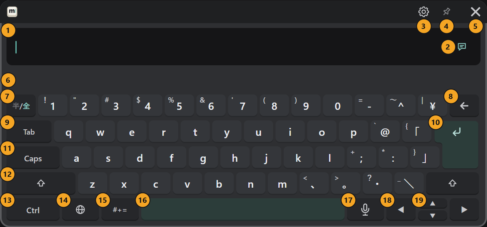

import YouTube from '@site/src/components/YouTube';

# 基本の操作

使い方の動画です。このページの操作を動画でも確かめられます。

<YouTube id="MDC7kWS27nE" title="MSKB -多言語対応VRキーボード- v1.0.0 使用方法" start={8} />

## コントローラーで操作する

| したいこと | 操作 |
|---|---|
| キーを押す | コントローラーでキーを指し、トリガーを引く |
| キーボードを動かす | キーボードを指し、グリップを握ったまま手を動かす |
| 大きさを変える | グリップとトリガーを押したまま、手を前へ出すと大きく、手前へ戻すと小さく |
| 長押しのキー（← ◀ ▶）を続ける | トリガーを引いたままにする |

動かない、大きさが変わらないときは、キーボード上部のピン（[各部](#キーボードの各部) の④）がオンになっていないか確かめます。
ポインターの向きが合わないときは、[ポインタの角度](../customize.md#ポインタの角度) を変えます。

## キーボードを開く・閉じる

| したいこと | 操作 |
|---|---|
| 開く・閉じる | 左手首を見ると出るボタン「MSKB」を指して押す |
| 目の前に呼び戻す | 手首のボタンを長押しする（閉じていれば開く） |
| 隠す | キーボード右上の「×」（⑤） |

コントローラーのボタンだけで開いたり、VRChat の入力欄と一緒に出したりもできます（[好みに合わせる](../customize.md#キーボードの開き方)）。

### 手首のボタンに出る状態

ボタンの「MSKB」の後ろに、今起きていることが出ます。

| 表示 | 意味 |
|---|---|
| キーボード | キーボードが開いている |
| 辞書 nn% | 変換の辞書を準備している（[初回の準備](./install.md#4-初回の準備を待つ)） |
| マイク / マイク nn% | 音声入力で聞き取っている / 音声入力の準備をしている |
| OSC エラー | VRChat へ送れない。PC の設定画面の「OSC」の接続先を確認する |

## キーボードの各部

画像は押すと拡大できます（スマートフォンでは元の大きさの画像が別のタブで開きます）。

### 上の部分（①〜⑥）

| 番号と名前 | 働き |
|---|---|
| ① 入力欄 | 打った文が出ます。文を押すと、その位置にカーソルを置きます。何か入っていると右端に「×」が出て、続けて 2 回押すと全部消えます |
| ② 送る先 | ↵ で送る先です。押すたびに、チャットボックス（吹き出し）と VRChat の入力欄が切り替わります（[送る](../send.md)） |
| ③ 歯車 | VR の中で設定と色を変えます（[VR の歯車](../settings/vr.md)） |
| ④ ピン | オンの間は、キーボードを掴んでも動きません。もう一度押すと戻ります |
| ⑤ × | キーボードを隠します |
| ⑥ 候補の段 | 変換の候補、英語の予測、辞書の準備の進み具合が出ます |

### 文字のキーのまわり（⑦〜⑫）

| 番号と名前 | 働き |
|---|---|
| ⑦ 半/全 | 日本語のまま、英数をそのまま打つ／かなに戻す |
| ⑧ ← | 1 字消します。長押しで続けて消します |
| ⑨ Tab | 候補の段で選ばれている候補を取ります |
| ⑩ ↵ | 送ります。変換中は確定、Shift を押した後は改行です |
| ⑪ Caps | 大文字を固定します。もう一度押すと戻ります |
| ⑫ Shift | 1 回押すと次の 1 字だけ、素早く 2 回押すと固定します |

### 一番下の段（⑬〜⑲）

| 番号と名前 | 働き |
|---|---|
| ⑬ Ctrl | 押した後に C・V・X・A・Z・Y で編集します（[編集する](../input/editing.md)） |
| ⑭ 🌐 | 入力する言語を選びます |
| ⑮ #+= | 記号・絵文字・顔文字・定型文のページを開きます |
| ⑯ 空白 | 空白を入れます。日本語を打っている途中は変換、中国語は一番目の候補を選びます |
| ⑰ マイク | 音声入力を始める・止めます（[音声入力](../input/voice.md)） |
| ⑱ ◀ ▶ | カーソルを動かします。変換中は、変換する区切り（文節）を移ります |
| ⑲ ▲ ▼ | 前に送った文を呼び出します |
