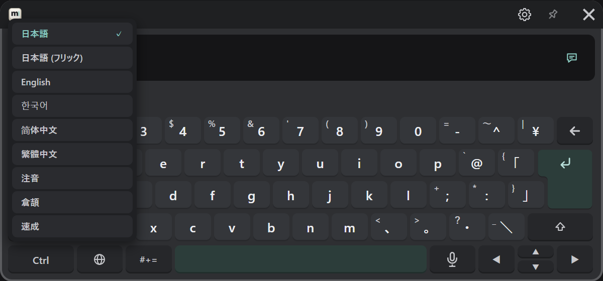

# はじめての送信

「こんにちは」を打って、VRChat のチャットボックスへ送ります。
VRChat の入力欄は閉じておきます。

## 1. 日本語を選ぶ

🌐 キーを押し、「日本語」を選びます。

## 2. 打って変換する

1. `konnnichiha` と打ちます。入力欄に「こんにちは」と出ます。
2. 漢字にしたいときは、空白キーで変換し、候補の段から選びます。
3. ↵ で確定します。

## 3. 送る先を確かめる

入力欄の右端（②）が吹き出しの印になっていることを確かめます。違う印のときは、押して切り替えます。

## 4. 送る

↵ を押すと、VRChat のチャットボックスに出ます。送れると入力欄が空になります。

:::tip 送れないとき
- VRChat の OSC がオンか確かめます（[インストールと起動](./install.md#5-vrchat-の-osc-をオンにする)）。
- 手首のボタンに「OSC エラー」と出ていないか確かめます。
- ほかは [FAQ](../faq.md#チャットボックスに送れない) を見てください。
:::

## 次に読む

- 英語・韓国語・中国語、フリック、記号の打ち方：[文字を入力する](/input)
- VRChat の入力欄へ入れる：[送る](../send.md)
