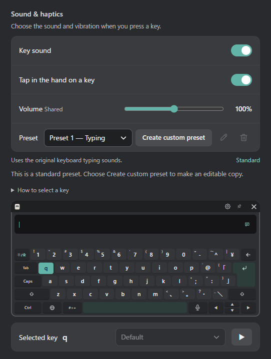
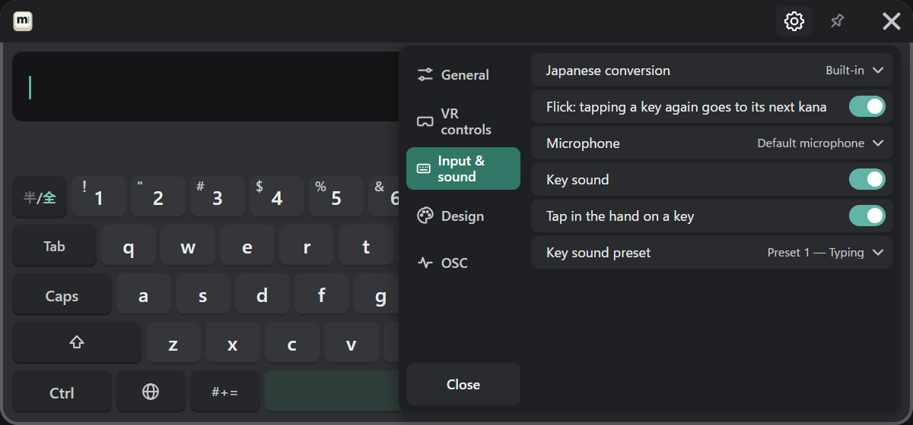
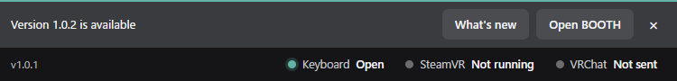
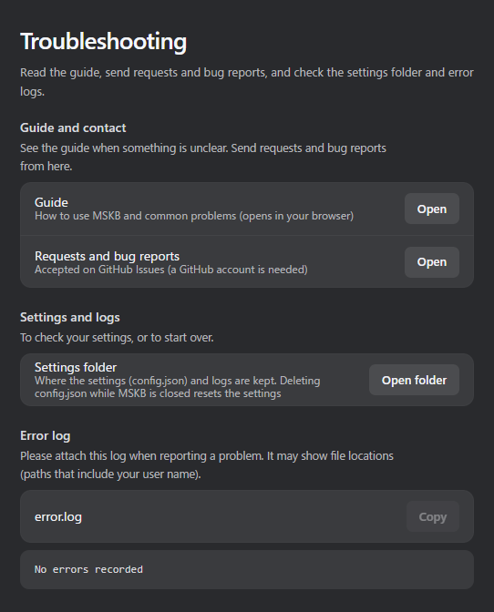
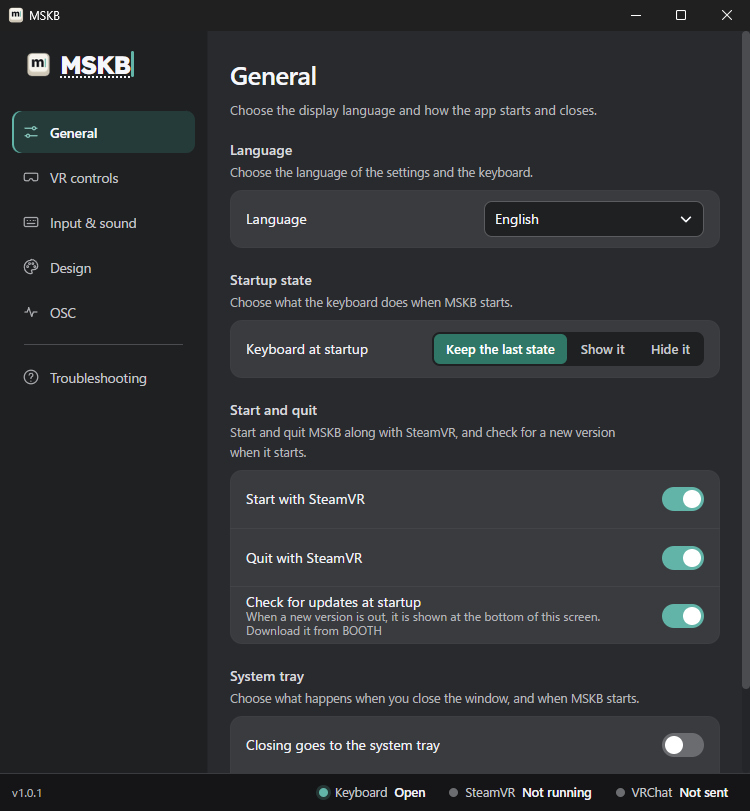

**MSKB v1.0.1** is out. Key sounds can now be switched with presets, and Japanese can be converted with the PC's own Japanese input method. The settings window is also clearer, while keeping the same order as the VR gear.

<!-- truncate -->

## New features

### Key sound presets

Key sounds can now be switched all at once. Besides the standard "Preset 1 — Typing" and "Preset 2 — Mechanical", you can save up to 32 custom presets tuned to your liking.

- "Create custom preset" makes a copy of the current preset, and you can change the sound of each key in it. Changes are saved automatically.
- Six more sounds to choose from.
- You can also choose the preset in the VR gear, under "Input & sound".

See [Key sound presets](/customize#key-sound-presets) for details.

### Choosing the Japanese conversion

If the PC has Microsoft IME, Google Japanese Input or Mozc, Japanese can be converted with it. Choose it under "Input & sound" → "Japanese conversion" (see [Japanese](/input/japanese#japanese-conversion)).

### New version notice

When a new version is out at startup, a notice appears at the bottom of the settings window. "What's new" opens this blog, and "Open BOOTH" opens the download page.

MSKB never downloads or updates by itself. If you don't want the notice, turn off "General" → "Check for updates at startup".

### Guide and contact

"Troubleshooting" in the settings window now opens this guide and the place for requests and bug reports (GitHub Issues).

## Improvements

- **Candidate row**: ‹ › at the right end now always shows while converting, however many candidates there are. Point at the candidate row and move sideways while holding the trigger to slide the candidates, like on a phone.
- **Settings window**: each page now starts with what you can do there. The order and icons now match the VR gear, with the settings that are also in the gear first.
- **VR gear**: when a list of choices is long, only the list scrolls.

## Download

- [Download (BOOTH)](https://misyaguziya.booth.pm/items/9093442)
- [Bugs & requests (GitHub Issues)](https://github.com/misyaguziya/MSKB-Docs/issues)
