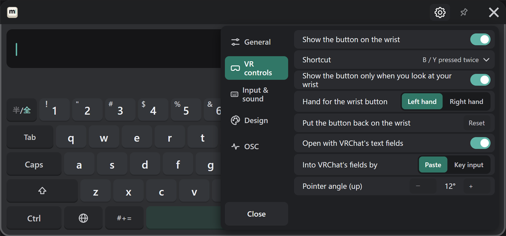
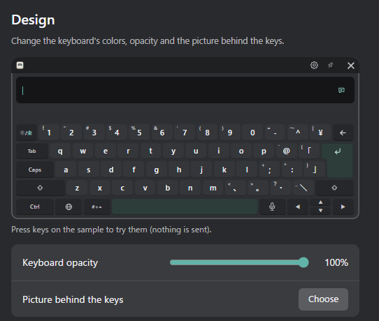
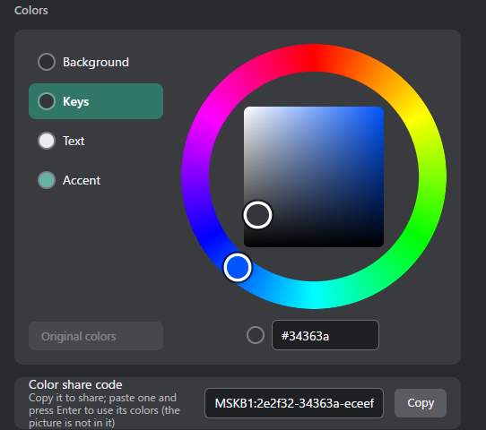
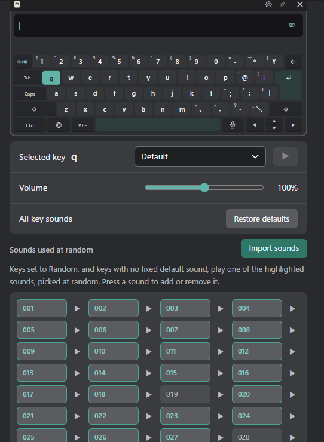

# Customizing

You can change settings either in the PC settings window or with the gear (③) on the keyboard in VR. Some settings are only on the PC (see [PC settings window](./settings/pc.md) and [VR gear](./settings/vr.md)).

## Opening the keyboard {#opening-the-keyboard}

Change these under "VR controls" in the settings.

| Setting | What it does |
|---|---|
| Show the button on the wrist | Shows the "MSKB" button on your wrist |
| Shortcut | Opens and closes the keyboard with a controller button |
| Open with VRChat's text fields | Opens the keyboard when you open a VRChat text field, and hides it when you close it |

The shortcut can be one of these.

| Shortcut | Do this |
|---|---|
| None | Not used |
| Stick pressed twice | Press the stick in twice |
| Hold B / Y | Hold the B or Y button |
| B / Y pressed twice | Press the B or Y button twice |

To remove the wrist button, choose a shortcut first (otherwise there would be no way to open the keyboard).

Whether the keyboard is open when MSKB starts is set with "General" → "Keyboard at startup" (Keep the last state / Show it / Hide it).

## The wrist button

Change these under "VR controls" in the VR gear.

| Setting | What it does |
|---|---|
| Show the button only when you look at your wrist | Shows the button only when your wrist faces you |
| Hand for the wrist button | Left hand or right hand |
| Put the button back on the wrist | Moves a misplaced button back to your wrist |

## Pointer angle {#pointer-angle}

Use this when the pointer doesn't match where you are pointing.
In the VR gear, under "VR controls" → "Pointer angle (up)", press − and + to change it one degree at a time.

## Bringing back a lost keyboard

- In VR: hold the wrist button.
- From your PC: press "VR controls" → "Bring in front" in the settings window (start SteamVR and wear your headset first). The keyboard opens if it was closed and comes in front of you.

## Looks {#looks}

| Setting | What it does | Where |
|---|---|---|
| Keyboard opacity | How see-through the whole keyboard is | PC, VR |
| Colors | Choose the background, key, text and accent colors on a color wheel | PC, VR |
| Picture behind the keys | Puts a picture of your choice behind the keys ("Remove" to undo) | PC |
| Color share code | Turns your colors into a code to share. Paste a code and press Enter to use those colors (the picture is not included) | PC |

Press the keys on the sample keyboard in the PC settings window to try the looks (nothing is sent to VRChat).

"Original colors" puts the selected part back to its first color.

## Sound and vibration

| Setting | What it does | Where |
|---|---|---|
| Key sound | Plays a sound when you press a key | PC, VR |
| Tap in the hand on a key | Vibrates the controller when you press a key | PC, VR |
| Key sounds | Choose the sound for each key | PC |

Key sounds play from the Windows default playback device. If you can't hear them in your headset, see the [FAQ](./faq.md#no-key-sound-in-headset).

### Choosing a sound for each key {#key-sounds}

Change these under "Input & sound" → "Key sounds" in the PC settings window.

1. On the sample keyboard, press the key you want to change. The language key switches the layout, and #+= opens the symbol page.
2. Choose a sound from the "Selected key" list. Press ▶ to listen.
3. "Volume" is shared by all keys (up to 200%).

"All key sounds" → "Restore defaults" puts every key's sound back to the default.

- **Random**: keys set to "Random" play one of the highlighted sounds under "Sounds used at random". Press a sound to add or remove it.
- **Import sounds**: add your own sounds (WAV, MP3 or Ogg, up to 512 KB and 3 seconds).
- The characters on the symbol page (symbols, emoji, kaomoji, phrases) share one setting.
