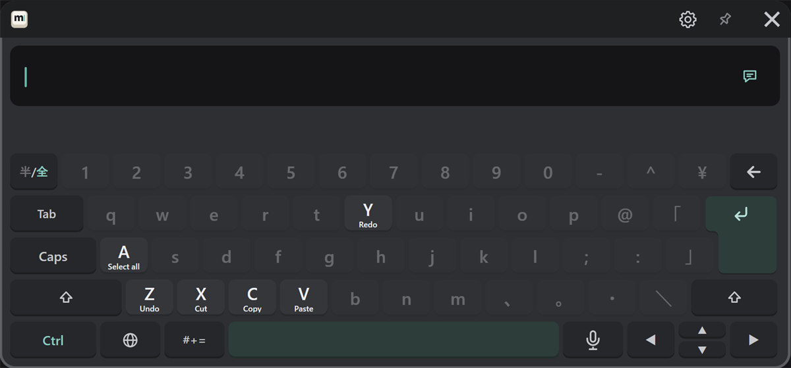

# Editing

## Moving the cursor

| To | Do this |
|---|---|
| Move one character | ◀ ▶ (hold to keep moving) |
| Move one word | Ctrl, then ◀ ▶ |
| Put it anywhere | Press that spot in the text field |
| Select | Shift, then ◀ ▶ |

## Deleting

| To | Do this |
|---|---|
| Delete one character | ← (hold to keep deleting) |
| Clear everything | Press the "×" at the right of the text field twice in a row |

The first press of "×" only changes its color, so a mistaken press doesn't erase anything.

## Copy, paste and undo

After you press Ctrl, only the keys you can use stay bright, with their action shown. Then press that key.

| Keys | Action |
|---|---|
| Ctrl → A | Select all |
| Ctrl → C | Copy |
| Ctrl → X | Cut |
| Ctrl → V | Paste |
| Ctrl → Z | Undo |
| Ctrl → Y | Redo |

The same actions are also buttons on the "#+=" → "Phrases" page (see [Symbols, emoji and phrases](./symbols.md#phrases-and-edit)).

Shift and Ctrl apply to the next key only when pressed once, and lock when pressed twice quickly. Press again while locked to unlock.

## New lines

Press Shift, then ↵, to start a new line without sending.

## Recalling sent messages {#recall}

Press ▲ to bring a message you sent before back into the text field. Press again for older ones, and ▼ to go back to newer ones.
Use it to send the same message again, or to fix a message slightly and send it again.

## Length

VRChat's chatbox shows up to 144 characters. When you are close to the limit, the character count appears at the right of the text field.
