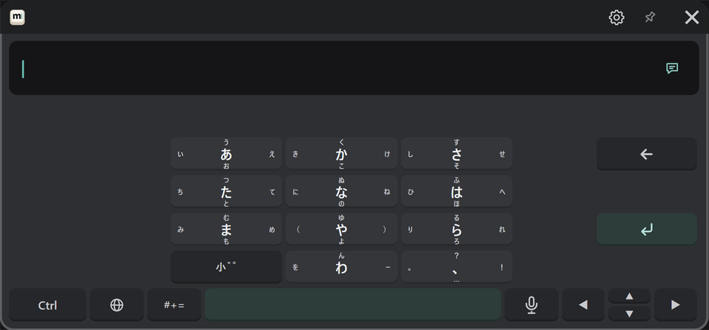
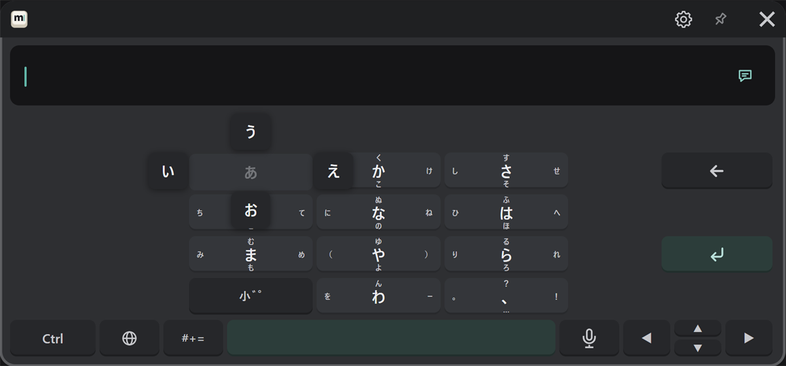

# Japanese (flick)

Choose "日本語 (フリック)" with the 🌐 key. The layout is the same as flick input on a smartphone.

## How to type

Point at a kana key, pull the trigger, move the pointer toward the character you want, and release.
While the trigger is pulled, the characters for the four directions appear around the key.

| Character | Do this |
|---|---|
| あ (center) | Press and release in place |
| い | Move left and release |
| う | Move up and release |
| え | Move right and release |
| お | Move down and release |

Pressing the same key again without moving goes to the next kana: あ → い → う, and so on.
To turn this off, turn off "Input & sound" → "Flick: tapping a key again goes to its next kana" in the settings.

## Dakuten, handakuten and small kana

The "小゛゜" key changes the last kana you typed to its dakuten, handakuten and small forms in turn (か → が, は → ば → ぱ, and so on).

## Converting and confirming

The same as romaji input (see [Japanese (romaji)](./japanese.md#type-and-convert)).
