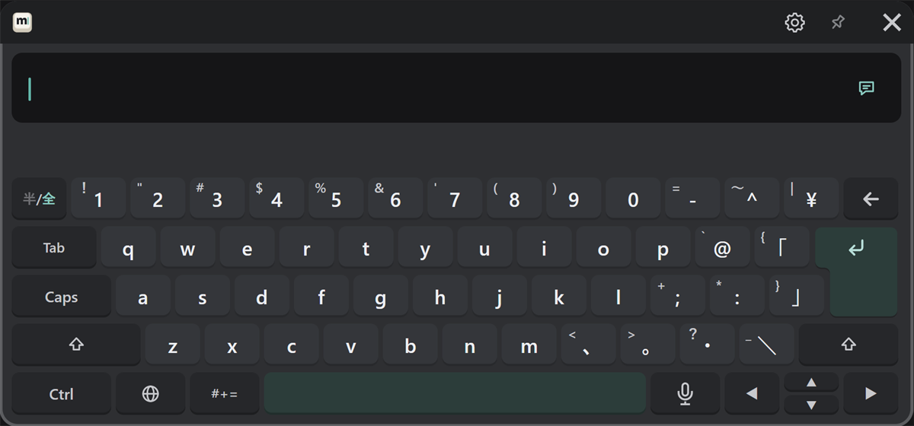
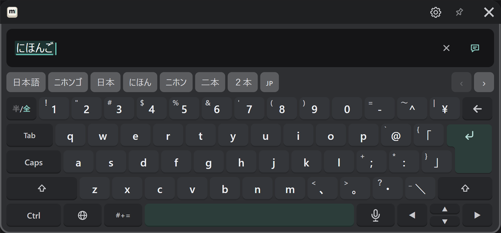
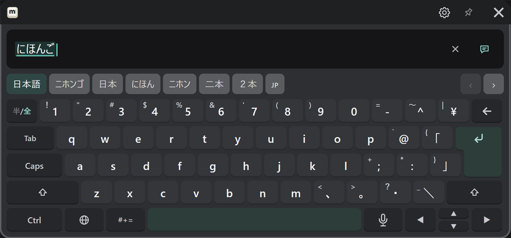

# Japanese (romaji)

Choose "日本語" with the 🌐 key. The keys are laid out like a Japanese (JIS) keyboard.

## Type and convert {#type-and-convert}

1. Type in romaji, and hiragana appears in the text field. Conversion candidates appear in the candidate row.

   

2. Press Space to convert. The selected candidate is highlighted. You can also press a candidate in the candidate row.

   

3. Press ↵ to confirm.

| To | Do this |
|---|---|
| Pick a candidate | Press it in the candidate row |
| See more candidates | ‹ › at the right end of the candidate row (always shown while converting, however many candidates there are) |
| See candidates that are cut off | Point at the candidate row and move sideways while holding the trigger (it slides like on a phone). Pushing the stick up or down slides it too |
| Move between the parts being converted | ◀ ▶ |
| Confirm | ↵ |
| Confirm and send | ↵ once more |

Candidates you pick often come first next time. To go back to the original order, press "Input & sound" → "Reset what conversion learned" in the PC settings (it takes effect the next time MSKB starts).

## Choosing the Japanese conversion {#japanese-conversion}

MSKB normally converts with the conversion built into it. If the PC has a Japanese input method (Microsoft IME, Google Japanese Input or Mozc), you can convert with that instead.
Choose it under "Input & sound" → "Japanese conversion" in the PC settings window or the VR gear. If the chosen one can't be used, MSKB goes back to its built-in conversion, and the VR gear says so.

## Type letters and numbers as they are

To type letters or numbers while staying in Japanese, press "半/全" at the top left. Press it again to go back to kana.
For whole sentences in English, switching to English with the 🌐 key is easier, since you get word suggestions (see [English](./other-languages.md#english)).

## Punctuation and symbols

"、", "。" and other marks are entered as printed on the keys. For symbols not on the keys, use "#+=" (see [Symbols, emoji and phrases](./symbols.md)).
