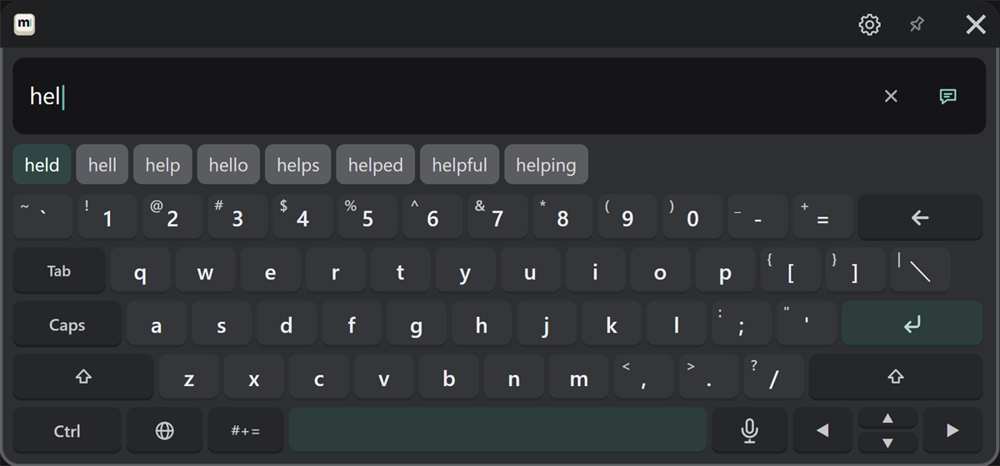
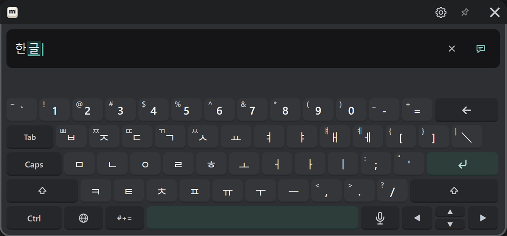
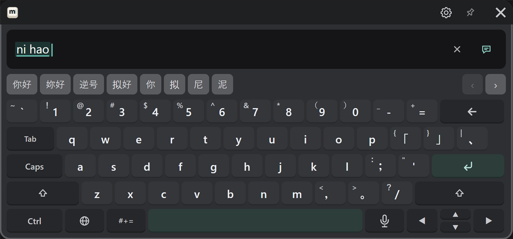
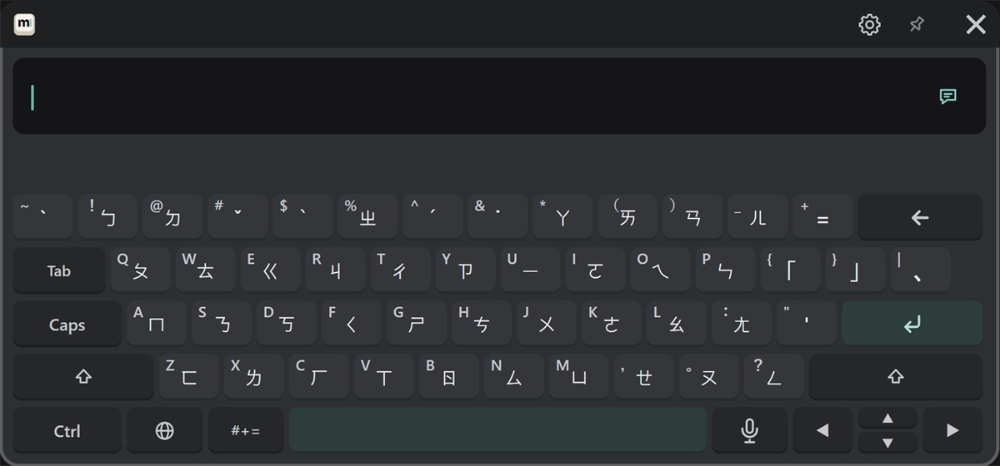
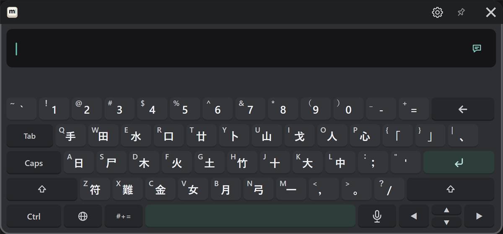

# English, 한국어, 中文

Choose a language with the 🌐 key. In every language, the small character at the top left of a key is the one you get with Shift.

## English {#english}

An English (US) layout. Suggestions for the word you are typing appear in the candidate row (the image shows "hel" typed).

- Press a suggestion to enter that word.
- Press Tab to enter the first suggestion (the highlighted one).
- Type capitals with Shift (next character) or Caps (lock).

## 한국어

The Korean 2-set (Dubeolsik, KS X 5002) layout. Jamo you type are combined into syllables automatically (the image shows "한글" typed). The candidate row is not used.

- For tense consonants (ㄲ ㄸ ㅃ ㅆ ㅉ) and ㅒ ㅖ, press Shift first.

## 简体中文 and 繁體中文 (Pinyin)

Choose "简体中文" or "繁體中文" with the 🌐 key. Type Pinyin, and Chinese character candidates appear in the candidate row (the image shows "nihao" typed).

| To | Do this |
|---|---|
| Pick the first candidate | Space |
| Pick another candidate | Press it |
| See more candidates | ‹ › at the right end of the candidate row |

The first time, the dictionaries are prepared (see [first-time setup](../start/install.md#first-time-setup)).

## Zhuyin, Cangjie and Quick

Choose "注音", "倉頡" or "速成" with the 🌐 key. They type Traditional Chinese.
The keys show Zhuyin symbols or Cangjie radicals. Typing and choosing candidates work the same as Pinyin.

**Zhuyin (注音)**

**Cangjie (倉頡) and Quick (速成)** (same key layout)

