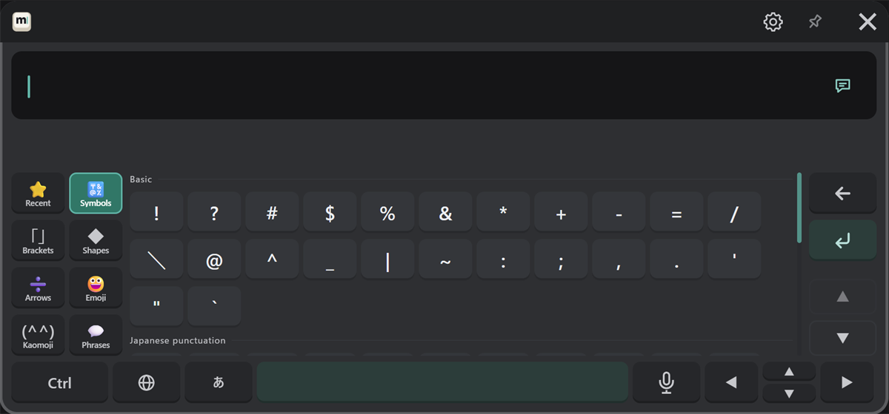
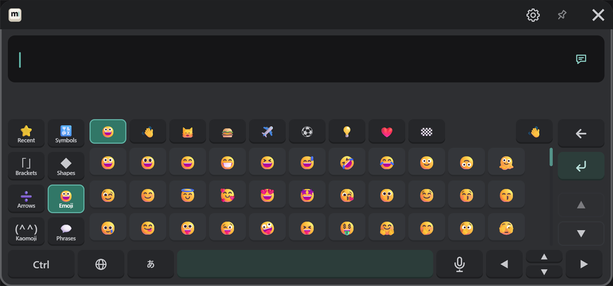
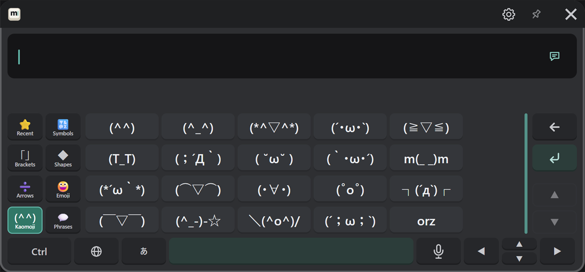
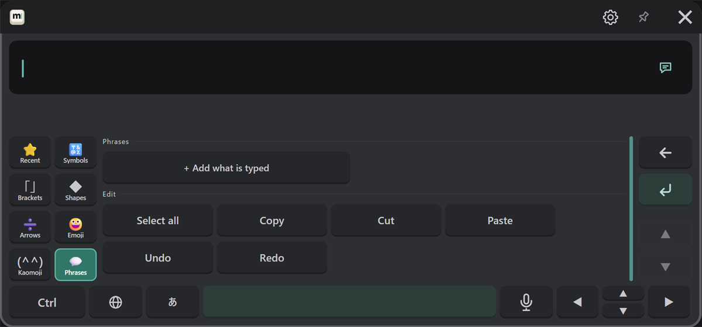

# Symbols, emoji and phrases

Press the "#+=" key, and the letter keys turn into the symbol page. Choose a kind with the tabs on the left, and press a character to enter it.
To go back to the letter keys, press the key in the same place (it shows the language's character).

| Tab | Contents |
|---|---|
| Recent | Symbols you entered recently (cleared when MSKB restarts) |
| Symbols | Basic symbols, Japanese punctuation, Chinese and Korean marks |
| Brackets | Brackets (both sides are entered, with the cursor between them) |
| Shapes | ☆ ○ ◇ □ △ ♪ ♡ and more |
| Arrows | Arrows, math and units (± ≠ ℃ and more), numbers such as ① and Ⅰ |
| Emoji | Emoji (with a skin tone choice) |
| Kaomoji | Kaomoji |
| Phrases | Your saved phrases, and edit buttons |

When a list is long, scroll it with ▲ ▼ on the right or with the controller stick.

## Emoji

Choose a group in the top row (smileys, people, animals and nature, food, places, activities, objects, symbols, flags).
The hand button at the top right chooses the skin tone.

## Kaomoji

## Phrases and edit {#phrases-and-edit}

Save messages you use often, and enter them with one press.

- **In VR**: type the message, then press "+ Add what is typed".
- **On your PC**: in the settings window, type it under "Input & sound" → "Phrases" and press "Add".

Under "Edit" are Select all, Copy, Cut, Paste, Undo and Redo buttons (the same as Ctrl).
