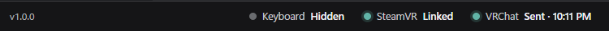

# Sending

Press ↵ to send the text in the text field. There are two send targets; switch between them with the icon at the right end of the text field (② in [the parts of the keyboard](./start/basics.md#parts)).

| Target | Icon | After sending |
|---|---|---|
| Chatbox | Speech bubble | It appears in VRChat's chatbox |
| VRChat's text field | The other icon | The text goes into VRChat's text field. Confirm or send it in VRChat |

:::note
The icon at the right end of the text field is not a send button. Each press switches the target. ↵ is what sends.
:::

## Sending to the chatbox

With VRChat's text field closed, set the target to the speech bubble and press ↵. When it is sent, the text field becomes empty.

- While you type, a typing indicator appears in VRChat's chatbox, and a notification sound plays when you send. You can turn both off under "OSC" in the settings.
- If it isn't sent, see the [FAQ](./faq.md#not-sent-to-the-chatbox).

## Entering text into VRChat's text fields {#vrchat-text-fields}

Use this for VRChat's text fields, such as searching for worlds or entering names.

1. Open the text field in VRChat.
2. Type in MSKB and press ↵. The text goes into that field.
3. Confirm it in VRChat.

While a VRChat text field is open, ↵ always enters text into that field, whatever the target icon shows (and the icon can't be switched). To send to the chatbox, close VRChat's text field.

Turn on "VR controls" → "Open with VRChat's text fields" in the settings, and the keyboard opens when you open a VRChat text field and hides when you close it.

:::caution About the clipboard
By default, MSKB enters text into VRChat's text fields through the clipboard. What was on the clipboard is replaced, and the text also stays in the Windows clipboard history.
If you don't want that, set "VR controls" → "Into VRChat's fields by" to "Key input" in the settings.
:::

If you see "VRChat was not found, so the text was only copied", the text could not be pasted into VRChat. Your text is still in the text field, so check VRChat and press ↵ again.

## Checking it was sent {#check-sent}

The bottom of the PC settings window shows whether MSKB could send to VRChat.

| Shown | Meaning |
|---|---|
| Keyboard Open / Hidden | Whether the keyboard is open in VR |
| SteamVR Linked / Not running | Whether SteamVR is running and MSKB is connected to it |
| VRChat Sent / Not sent / Error | Whether MSKB could send to VRChat over OSC. On "Error", check the address under "OSC" |

"Sent" means MSKB sent it. It can't tell whether VRChat received it.

## Sending the same message again

Press ▲ to recall a message you sent before (see [Editing](./input/editing.md#recall)).
