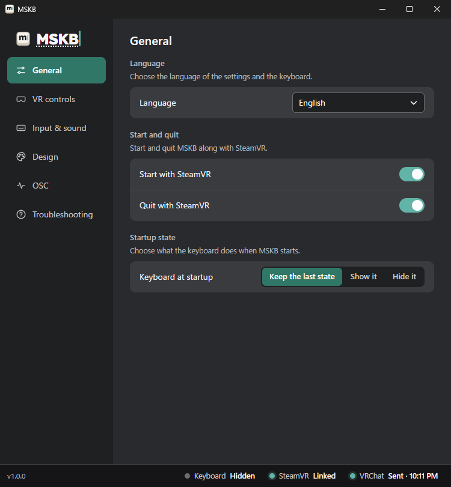
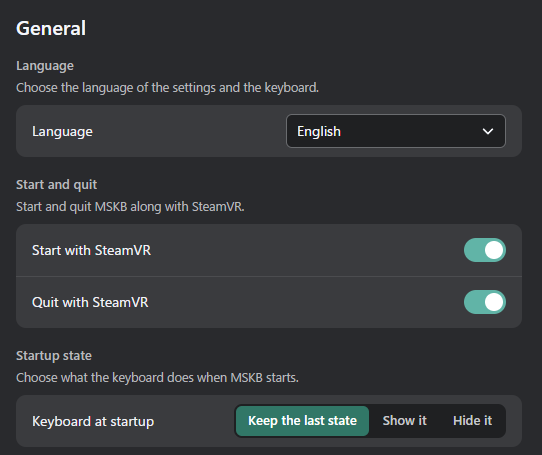
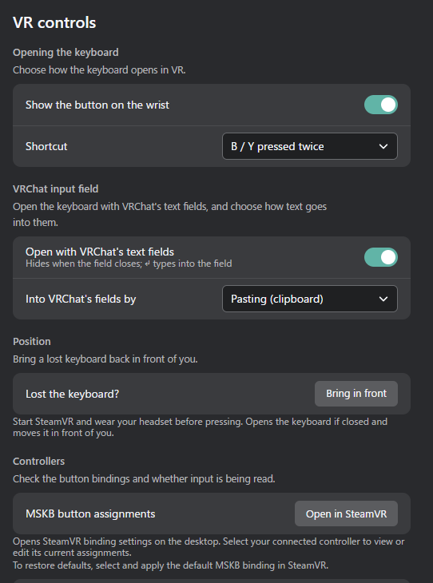
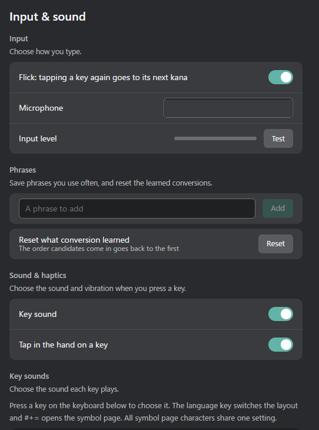
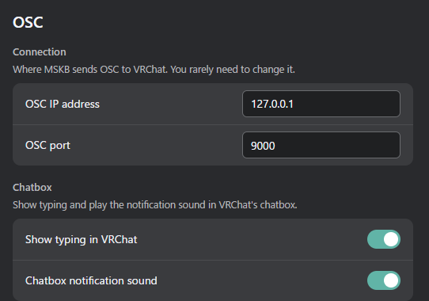
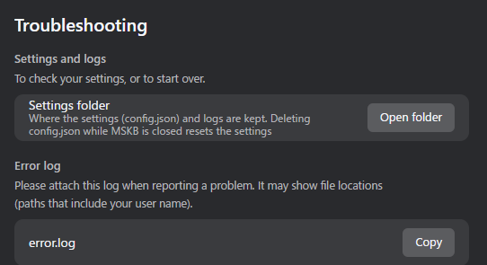

# PC settings window

Press the MSKB icon in the Windows notification area (system tray), or right-click it and choose "Open MSKB".

Switch tabs with the list on the left. The bar at the bottom shows the current status (see [Checking it was sent](../send.md#check-sent)).
Settings marked ○ in the "VR" column can also be changed with the [VR gear](./vr.md). Both change the same settings.

## General

| Setting | What it does | VR |
|---|---|---|
| Language | The language of the settings window and the keyboard | ○ |
| Start with SteamVR / Quit with SteamVR | Starts and quits MSKB along with SteamVR | |
| Keyboard at startup | Keep the last state / Show it / Hide it | ○ |
| Closing goes to the system tray | The window's "×" goes to the tray instead of quitting (off by default) | |
| Start in the system tray | Doesn't show the settings window at startup | |

## VR controls

| Setting | What it does | VR |
|---|---|---|
| Show the button on the wrist / Shortcut | How to open the keyboard (see [Customizing](../customize.md#opening-the-keyboard)) | ○ |
| Open with VRChat's text fields | Opens the keyboard together with VRChat's text fields | ○ |
| Into VRChat's fields by | Pasting (clipboard) / Key input (see [Sending](../send.md#vrchat-text-fields)) | ○ |
| Lost the keyboard? | "Bring in front" brings the keyboard in front of you | |
| MSKB button assignments | Opens SteamVR's button assignment screen | |
| Input diagnostics | Checks whether MSKB can read your controller input (see the [FAQ](../faq.md#keys-dont-respond)) | |

## Input & sound

| Setting | What it does | VR |
|---|---|---|
| Flick: tapping a key again goes to its next kana | In [flick input](../input/flick.md), pressing the same key again goes to the next kana | ○ |
| Microphone / Input level | The microphone for voice input, and a test | Microphone only |
| Phrases | Saving messages you use often | |
| Reset what conversion learned | Puts the order of frequently picked candidates back to the start (from the next start) | |
| Key sound / Tap in the hand on a key | Sound and vibration on or off | ○ |
| Key sounds | A sound for each key, volume, imported sounds (see [Customizing](../customize.md#key-sounds)) | |

## Design

| Setting | What it does | VR |
|---|---|---|
| Keyboard opacity | How see-through it is | ○ |
| Picture behind the keys | A picture behind the keys | |
| Colors | Background, keys, text, accent | ○ |
| Color share code | Share colors as a code | |

The images are on [Customizing](../customize.md#looks).

## OSC

| Setting | What it does | VR |
|---|---|---|
| OSC IP address / OSC port | Where MSKB sends to VRChat. You normally don't need to change these | |
| Show typing in VRChat | Shows a typing indicator in the chatbox while you type | ○ |
| Chatbox notification sound | Plays VRChat's notification sound when you send | ○ |

## Troubleshooting

| Setting | What it does |
|---|---|
| Settings folder | Opens the folder with your settings and logs. To reset your settings, follow the note on the screen |
| Error log | The log to attach when reporting a problem. "Copy" copies it |

:::caution
The log may show file locations that include your user name. Remove the user name before posting it anywhere public.
:::
