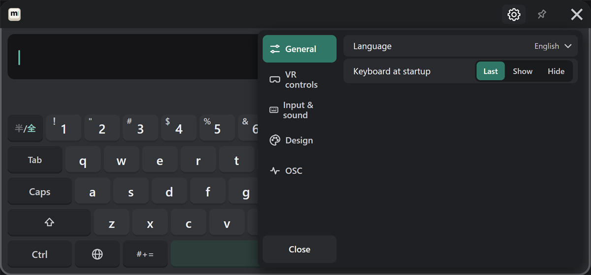
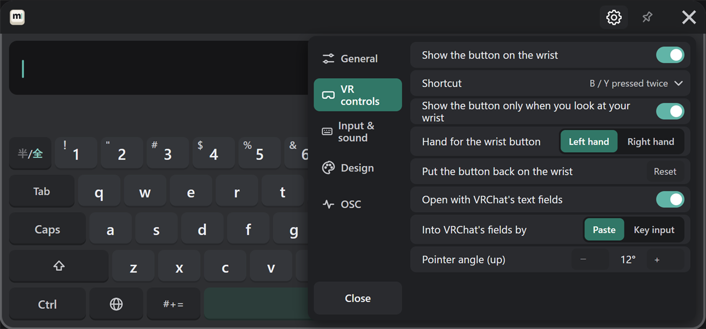
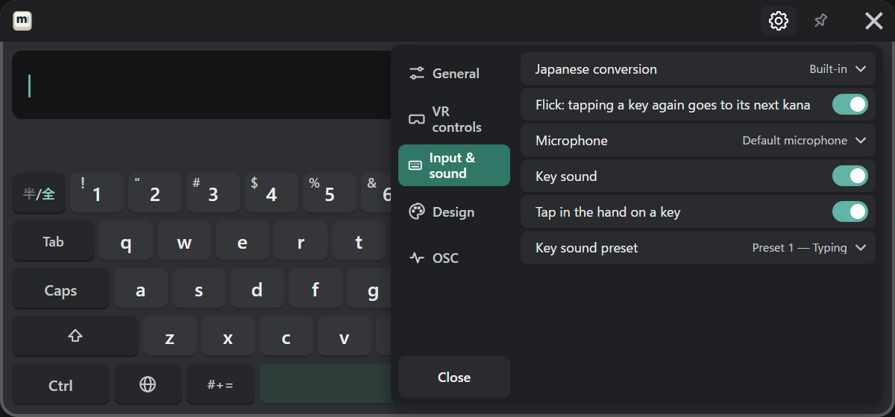
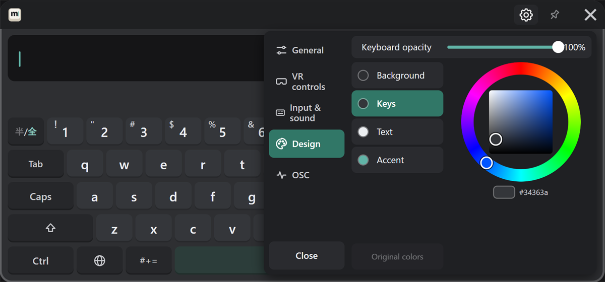
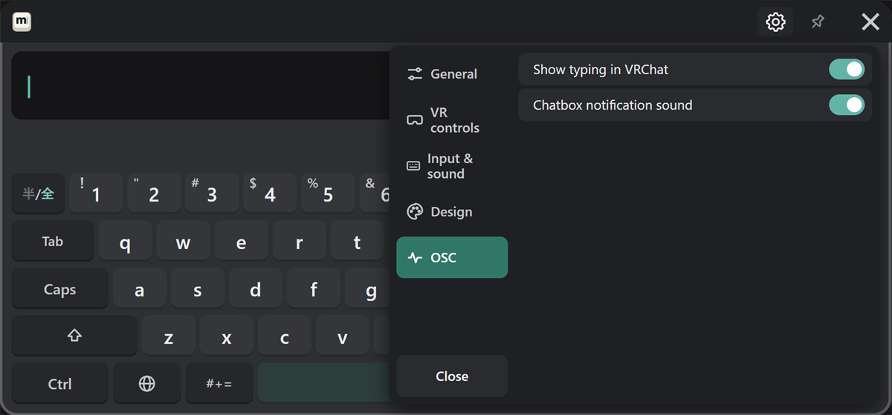

# VR gear

Press the gear at the top right of the keyboard (③ in [the parts](../start/basics.md#parts)), and the settings open over the keyboard.
Switch tabs on the left, and press "Close" to go back. Only settings that make sense to change in VR are here, and they are the same settings as in the [PC settings window](./pc.md). The tabs also have the same names and order as there.

A setting with ⌄ on the right opens its list of choices in place. When the list is long, point at it and push the stick up or down: only the list scrolls.

## General

Change the language and the keyboard at startup (last / show / hide).

## VR controls

| Setting | What it does |
|---|---|
| Show the button on the wrist / Shortcut | How to open the keyboard (see [Customizing](../customize.md#opening-the-keyboard)) |
| Show the button only when you look at your wrist / Hand for the wrist button / Put the button back on the wrist | The wrist button (see [Customizing](../customize.md#the-wrist-button)). Only in the VR gear |
| Open with VRChat's text fields / Into VRChat's fields by | See [Sending](../send.md#vrchat-text-fields) |
| Pointer angle (up) | − and + change it one degree at a time (see [Customizing](../customize.md#pointer-angle)). Only in the VR gear |

## Input & sound

| Setting | What it does |
|---|---|
| Japanese conversion | What converts Japanese (see [Japanese](../input/japanese.md#japanese-conversion)). Shown only when the PC has a Japanese input method |
| Flick: tapping a key again goes to its next kana | How [flick input](../input/flick.md) behaves |
| Microphone | The microphone for voice input |
| Key sound / Tap in the hand on a key | Sound and vibration on or off |
| Key sound preset | A set of key sounds (see [Customizing](../customize.md#key-sound-presets)). Custom presets made on the PC are listed too |

## Design

- **Opacity**: point at the slider and move it while holding the trigger.
- **Colors**: choose the part (background, keys, text, accent), then pick a color on the wheel. "Original colors" puts it back.

The picture behind the keys and the color share code are changed in the PC settings window.

## OSC

Choose whether to show typing in VRChat, and whether to play the chatbox notification sound.
