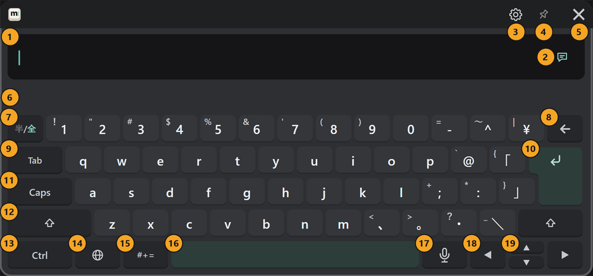

# The basics

## Using the controllers

| To | Do this |
|---|---|
| Press a key | Point at the key with a controller and pull the trigger |
| Move the keyboard | Point at the keyboard, hold the grip and move your hand |
| Resize it | Hold the grip and the trigger; move your hand forward to enlarge, back toward you to shrink |
| Repeat a key (← ◀ ▶) | Keep the trigger pulled |

If the keyboard won't move or resize, check that the pin at the top of the keyboard (④ in [the parts](#parts)) is not on.
If the pointer direction feels off, change the [pointer angle](../customize.md#pointer-angle).

## Opening and closing the keyboard

| To | Do this |
|---|---|
| Open or close | Look at your left wrist and press the "MSKB" button that appears |
| Bring it in front of you | Hold the wrist button (opens the keyboard if closed) |
| Hide it | The "×" at the top right of the keyboard (⑤) |

You can also open it with a controller button alone, or have it open together with VRChat's text fields (see [Customizing](../customize.md#opening-the-keyboard)).

### Status on the wrist button

After "MSKB", the button shows what is happening now.

| Shown | Meaning |
|---|---|
| Keyboard | The keyboard is open |
| Dictionary nn% | Preparing the conversion dictionaries ([first-time setup](./install.md#first-time-setup)) |
| Microphone / Microphone nn% | Listening for voice input / preparing voice input |
| OSC Error | MSKB can't send to VRChat. Check the address under "OSC" in the PC settings |

## The parts of the keyboard {#parts}

Press an image to enlarge it (on a phone, the full-size image opens in a new tab).

### Top (① to ⑥)

| Number and name | What it does |
|---|---|
| ① Text field | Shows what you type. Press a spot in the text to put the cursor there. When there is text, a "×" appears at the right; press it twice in a row to clear everything |
| ② Send target | Where ↵ sends. Each press switches between the chatbox (speech bubble) and VRChat's text field (see [Sending](../send.md)) |
| ③ Gear | Settings and colors inside VR (see [VR gear](../settings/vr.md)) |
| ④ Pin | While on, grabbing the keyboard doesn't move it. Press again to turn it off |
| ⑤ × | Hides the keyboard |
| ⑥ Candidate row | Shows conversion candidates, English word suggestions, and dictionary setup progress |

### Around the letter keys (⑦ to ⑫)

| Number and name | What it does |
|---|---|
| ⑦ 半/全 | While in Japanese, types letters and numbers as they are / back to kana |
| ⑧ ← | Deletes one character. Hold to keep deleting |
| ⑨ Tab | Takes the highlighted candidate in the candidate row |
| ⑩ ↵ | Sends. While converting, it confirms; after Shift, it starts a new line |
| ⑪ Caps | Locks capital letters. Press again to unlock |
| ⑫ Shift | Press once for the next character only, twice quickly to lock |

### Bottom row (⑬ to ⑲)

| Number and name | What it does |
|---|---|
| ⑬ Ctrl | Then press C, V, X, A, Z or Y to edit (see [Editing](../input/editing.md)) |
| ⑭ 🌐 | Chooses the input language |
| ⑮ #+= | Opens the page of symbols, emoji, kaomoji and phrases |
| ⑯ Space | Types a space. While typing Japanese it converts; in Chinese it picks the first candidate |
| ⑰ Microphone | Starts and stops voice input (see [Voice input](../input/voice.md)) |
| ⑱ ◀ ▶ | Moves the cursor. While converting, moves between the parts being converted |
| ⑲ ▲ ▼ | Recalls messages you sent before |
