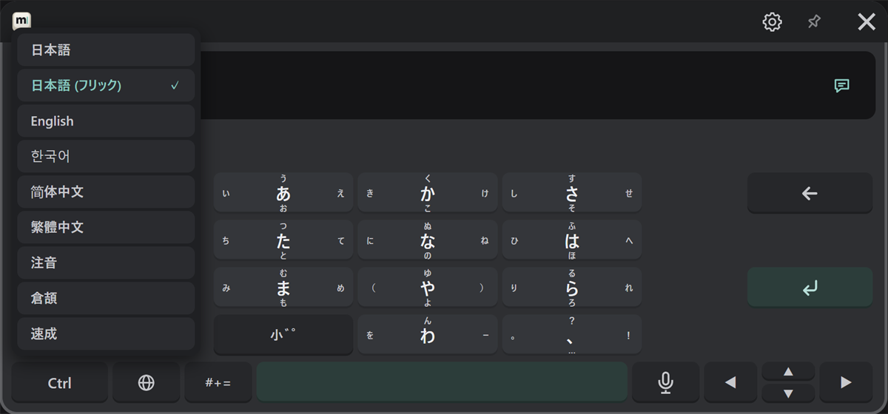

# Your first message

Type "hello" and send it to VRChat's chatbox.
Keep VRChat's text field closed.

## 1. Choose English

Press the 🌐 key and choose "English". The list shows each language in its own script.

## 2. Type

Type `hello`. Word suggestions appear in the candidate row; press one to use it, or press Tab to take the highlighted one.

## 3. Check the send target

Check that the right end of the text field (②) shows the speech bubble. If it shows the other icon, press it to switch.

## 4. Send

Press ↵. The message appears in VRChat's chatbox, and the text field becomes empty.

:::tip If it isn't sent
- Check that OSC is on in VRChat (see [Installing and starting](./install.md#turn-on-osc)).
- Check that the wrist button doesn't show "OSC Error".
- Otherwise, see the [FAQ](../faq.md#not-sent-to-the-chatbox).
:::

## Next

- Japanese, Korean, Chinese, flick input and symbols: [Typing](/input)
- Entering text into VRChat's text fields: [Sending](../send.md)
